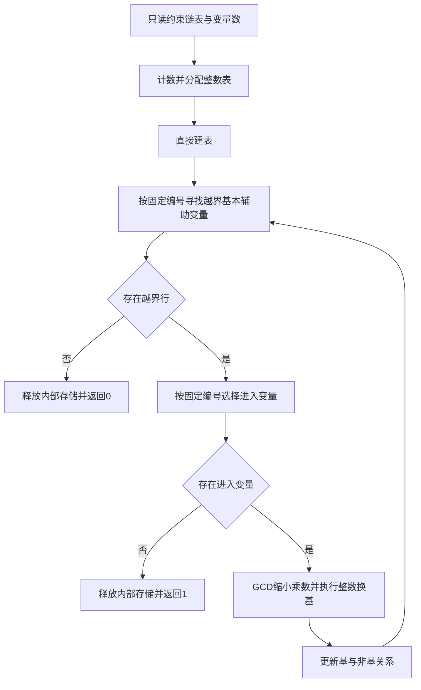

# GMP FME 风格整数单纯形开发规约

日期：2026-11-11。

新版本工作目录：`/home/maxu/Projects/qcp-simplex-gmp-minimal`。

本项目实现只返回 0 或 1 的有理线性可行性判定内核，使用项目 MiniGMP 整数和整数单纯形换基。以 QCP GMP FME 的接口职责、直接流程及前置条件式规约为主要参考；旧整数单纯形仅提供算法数学参考。不要整体复制旧工程后再删减，应从本规约定义的最小实现开始。

当前仅建立开发文档，尚未实现或完成形式化证明。后续开发在本目录进行，不修改原 QCP、旧独立模块或历史实验。

## 参考依据

主要参考：`/home/maxu/Projects/qcp-v2.2.0/QCP_examples/Applications_human/gmp/fme/fme_gmp.c` 及同目录 `fme_def.h`。前者已核对 SHA256：`1db879c4978aba0bde80140ce9ef699b1738b91fdc0e8ef0485b1b3689f8bfaa`。

次要参考：`/home/maxu/Projects/qcp-simplex-gmp` 当前未提交工作树中的 `solver.c` 和 `int_table.c`。参考选择规则及整数换基关系，不继承 Prepared、资源事务、公开结果对象或独立检查器架构。该目录 HEAD 不能代表当前源码。

不混用 SMT 工程 int FME、完整 SMT 接口和 QCP GMP FME。FME 返回 0 不表示整数 SAT，也不提供具体赋值。旧模块关于 UNKNOWN、预算、见证及运行时复核的要求已被用户对本新版本的最小化要求替代。

## 输入输出契约

```c
struct InequList {
    mpz_ptr coef;
    struct InequList *next;
};

int sx_check_qcp(const struct InequList *head, size_t variables);
```

每个节点含 n+1 个已初始化的项目 MiniGMP 整数，表示 `coef[0] + Σ coef[j]*x[j] <= 0`。变量按有理数解释，原变量自由。链表有限、无环、NULL 终止，最后节点有效，没有尾哨兵。NULL 输入表示空约束。

输入由调用方持有，调用期间有效、稳定，求解器只读且不释放。等式由上层拆成两条非严格不等式；严格不等式、析取、不等关系不直接输入，不能把有理严格不等式简单加减 1 后输入。

| 正常返回值 | 在前置条件成立时的后置条件 |
|---|---|
| 1 | 原约束无有理解，因此无整数解 |
| 0 | 原约束有有理解；不判断是否有整数解 |

不输出具体解、公共分母、证据、统计、原因或 UNKNOWN。不设拥有型结果对象，不需要结果 init/clear。不得把执行失败伪装成 0 或 1。

## 前置条件与证明边界

调用方和外部服务保证输入合法、整数表示合法、维度及派生尺寸可表示、所需内存分配成功、MiniGMP 操作满足其规约。索引、容量和后端长度运算需要相应的不溢出条件。初始系数小不意味着所有换基中间数小，后续证明需覆盖实际增长条件。

核心不运行输入验证、尺寸溢出检查、OOM 恢复或资源预算。形式化验证分别承担部分正确性、正常路径内存安全和清理、终止性。不能以输入合法代替终止证明，不能继承旧 FME 的证明结论。

## 最小流程



### 直接建表

每个原行对应一个辅助变量 `s_i=c_i0+Σc_ij*x_j`，其上界为零。保留原行和原变量顺序；初始原变量全部非基且取零，辅助变量全部基本。

表表示 `D[r]*x_basic[r]=C[r]+ΣA[r,v]*x_v`，D>0，和式只含非基变量。初始 D=1，C 和系数直接从输入导入。

布局以简单实现和证明为准，允许使用含零基本列的稠密表；只保留选择和换基真正需要的基／非基关系，不保存恒等行列映射。不要预建复杂存储抽象。

不设独立预处理框架，不压缩变量，不做输入整行 GCD 缩放，不建 Prepared 或系数中间矩阵。2026-11-12首批优化增加建表前的常数矛盾扫描；常数真行仍直接建表。空约束、零变量须在同一流程中有明确表示。

### 越界与进入选择

非基值为零，基本值为 C/D。按稳定辅助变量编号寻找基本且 C>0 的辅助变量；没有则返回 0。不构造见证、不求公共分母、不代回原输入，依据表关系与循环不变量证明可行性。

对越界行按稳定变量编号选非基变量：原变量系数非零即可进入；辅助变量系数必须为正。前者可以双向移动，后者从零只能向负方向移动。

无进入变量时，该行满足 `D*s_b=C+ΣA_j*s_j`，D>0、C>0，非零非基项均来自辅助变量且 A_j<0。结合 s_j<=0，右侧严格为正而左侧应不大于零，故返回 1。

符号和候选判断属于算法决策，与 FME 分组及常数矛盾判断一样必须保留；不添加阻塞条件二次复核、原行权重证据或验证器。

### 整数换基

以非零进入系数重写枢轴行，通过符号调整使新 D 为正，然后消去其他行的进入变量。令新枢轴行分母为 P，其他行进入系数为 h，用 `g=gcd(P,h)`、`M=P/g`、`N=h/g` 组合整数行。

GCD 缩小乘数与 FME 一致，保留。正分母由构造建立，不作事后二次检查。2026-11-12首批优化增加枢轴行及受影响行的整行GCD约简，以控制整数增长；它是等价缩放，不是运行时复核。

直接更新表，仅保存覆盖前确有依赖的旧枢轴数据及临时整数。不建立完整候选表，不执行验证后提交或回滚。不能机械去掉旧实现的 clone 后沿用有别名依赖的更新代码，须先确定公式与覆盖顺序。

更新基／非基关系后回到选择循环。固定顺序属于算法定义；终止性应针对实际规则证明，不能用“类似 Bland”代替证明。

## 不引入的功能

- Q/Z 双状态、UNKNOWN、诊断分类、统计和公开结果对象。
- 可行见证、公共分母、整体约简、原约束代回复核。
- 原行冲突证据及复核、阻塞条件二次检查。
- 表结构二次检查、候选换基独立等价检查和最终 checkpoint。
- 输入防御性检查、动态溢出拒绝、故障注入接口。
- limb、内存、时间和换基次数预算及可恢复失败协议。
- Tx、scope、setjmp/longjmp 事务和逐运算 bool 传播。
- 预处理配置、压缩、缩放恢复和中间矩阵。
- 整数搜索、分数解后补约束重试、SMT 集成。
- 通用插件框架、第二套算术抽象和复杂发布工具。

正常路径的分配、初始化、临时整数释放和内部表销毁必须保留，与 FME 的正常清理一致。后端需要的最小分配辅助函数保留，不复用旧事务运行时。直接使用项目 MiniGMP 算术及适用位置的 mpz_addmul，不重写大整数算法。

## 开发阶段

### 第一阶段 布局与依赖

确定最小表结构、稳定变量编号、基关系、临时数据和所有权。列出 MiniGMP 来源及必要分配辅助函数；给出换基公式与覆盖顺序，审清别名依赖。不要先复制旧目录、测试体系和运行时。

### 第二阶段 最小实现

实现直接建表、越界选择、进入选择、整数换基、两个返回出口和正常清理。少量函数按真实职责组织；不为减少行数合并成大函数或压缩排版，不预建通用层。后续全部实现位于本新目录。

### 第三阶段 测试与规约

用独立测试构造输入并检查明确的 0/1 结果。oracle 和调试检查留在测试侧，不加入生产执行流程。整理建表、选择、换基及返回分支的待证明规约，明确尚未完成的证明。

每阶段报告改动、规模、测试与问题。未经要求不提交、推送，不修改原项目和历史实验。若委派开发，使用用户指定的 GPT-6 Astra low 子代理，由主代理持续监督、审查和验收，不得只启动便结束跟进。

## 验收范围

| 案例 | 预期 |
|---|---:|
| 空约束，零维或多维 | 0 |
| 常数 -1<=0、0<=0 | 0 |
| 常数 1<=0 | 1 |
| x>=1 且 x<=0 | 1 |
| 两条不等式表示 2x=1 | 0 |
| 两条不等式表示 2x=2 | 0 |
| 需要负值的可行例 | 0 |
| 零系数、冗余、未用变量 | 与原约束有理可行性一致 |
| 多次换基、不同枢轴符号、大整数 | 与独立数学预期一致 |

2x=1 返回 0 是必要案例，防止误解为整数 SAT。另覆盖单节点、末节点、空行列存储、输入不变和内部释放。允许普通编译警告、ASan/UBSan、自编精确数学测试。合法域外与实际 OOM 不作为可恢复行为验收。

对照 GMP FME 只比较双方适用输入上的语义，不以 FME 为绝对正确 oracle，不继承旧证明。工程测试不替代形式化验证。

## 防止过量开发

每个新增字段、函数或分支必须归属于建表、选择、换基、正常清理或必要 MiniGMP 适配。额外诊断、复核、恢复和优化先提出，不默认加入。

目标是减少职责、状态和转换阶段，不靠搬移代码制造删减。无需预设与 FME 完全相同行数，但单纯形新增的基关系和换基表示必须有具体用途。阶段统计同时列出算法自有代码与后端适配，不隐藏复杂度。
## 详细前置条件

输入和正常执行契约以 [INPUT_CONTRACT.md](INPUT_CONTRACT.md) 为详细说明，区分调用方条件、外部服务假设和必须由实现证明的不变量；不新增生产检查或错误分支。

## 首批优化修订 2026年11月12日

当前流程在建表前扫描正的常数矛盾行，可直接返回1；换基中规范化枢轴行后使用新的正分母形成组合，再规范化受影响行。其余框架不变。该修订替代原流程对这两项优化的排除，不恢复映射、候选表、预算或数学检查器。
