# library-spec-tool 开发指南

更新时间：2026-11-09。本文以当前代码入口和交接校验为依据，作为项目结构、流程与维护工作的统一入口。它描述工具当前能做什么，不把历史实验成功等同于默认工具已经自动实现。

项目根目录：

- WSL：`/home/maxu/Projects/library-spec-tool`。
- Windows：`\\wsl.localhost\Ubuntu-24.04\home\maxu\Projects\library-spec-tool`。
- 运行环境：Ubuntu-24.04 WSL；命令示例均在项目根目录的 Linux shell 执行。
- 开始工作前检查目录层级内适用的 `AGENTS.md`。不要修改历史实验的验收或封存文件。

规约书写要求维护在项目根目录的[规约书写规范](SPECIFICATION_WRITING_GUIDE.md)。隔离副本随工具复制此文件；阶段四从当前代码根目录解析其绝对路径，并记录实际交付内容的 SHA-256。历史实验的归档内容已按 2026-11-11 的清理范围精简。

## 当前开发计划

截至 2026-11-09，阶段四第一轮已实现并完成固定响应验收，第二轮已完成材料交付改造和离线对照。改动前的实现可用 Git 标签 `pre-stage4-rework-20261109` 对照。

**阶段四职责**是根据阶段三交付的本批函数规约和对应实现，从已证明参考库中筛选定义、引理、表示方式和相关 strategy，向后续 QCP agent 交付原文位置、关键前提、目标用途和适配限制。参考库已经完成验证。本次未定位到原文，仅影响本轮推荐的依据。完整的新定义、引理设计和目标端证明留给后续步骤。

### 第一轮 · 交付内容与审查条件（已实现）

| 工作 | 主要修改位置 | 可核对的结果 |
|---|---|---|
| 明确需求来源 | `stage4/pipeline.py`、`prompts.py` | 程序交付实际存在的上游需求和本轮从规约提取的需求，标明来源。旧版可选字段 `common_needs` 缺省时仍能从 `suggested_spec` 开始。需求写明条款、使用位置和检索问题。 |
| 修改输出协议 | `stage4/planning.py`、`contracts.py`、`prompts.py`、`COMMON_CONTENT_TEMPLATE.md` 和汇总输出 | 共享参考记录给出来源、原陈述或定义含义及前提。函数使用说明通过引用 ID 关联用途、差异和待确认事项。取消逐项设计新引理及必填验证计划的要求。目标适配显式标为未验证。 |
| 调整审查和交付 | `stage4/contracts.py`、`components.py` 和审查提示词 | 每项检索可记录直接参考、需适配或仅借鉴思路、已查范围内未找到、适用性待定。错引、解释错误、漏掉前提或夸大用途时修订相应判断。有缺口时可交付其余已核实参考。strategy 仅附直接相关的已有规则，空附件可正常交付。 |
| 更新状态和恢复 | `stage4/pipeline.py`、`recovery.py` 及受影响的恢复、修订入口 | 区分运行状态、审查结论、目标端验证状态和历史错误。恢复后摘要显示当前结果。给新报告标记协议版本，旧报告按原协议解释，避免跨版本沿用审查结论。 |

#### 第一轮具体交付

沿用现有文件名，升级内容协议。QCP agent 读 `candidate.md` 时，应能按目标函数找到可采用的参考、原文位置、适配限制和审查结果；机器读取端用以下记录获得相同结论。

| 文件 | 谁写入，包含什么 | 如何检查 |
|---|---|---|
| `functions/<函数ID>/common_needs.json` | 程序记录上游可选字段是否存在，保留原有需求。提取任务为新增检索问题记录函数 ID、需求 ID、规约条款和使用位置。 | 分别输入字段缺省、显式空数组和非空数组。前两种仍可从规约提取问题；第三种可追溯到原条目。 |
| `candidate.json`、`planning.json` | 一条参考记录有唯一 ID、来源位置、原意和关键前提。函数使用记录以函数 ID 和需求 ID 定位，写检索结果、参考 ID、适配差异或检索限制。程序从同一份候选生成索引。 | 直接参考或适配必须关联存在的参考 ID；已检查范围内未找到时允许空 ID 列表，但须说明实际查过哪里；有候选而适用性待定时写明具体疑点。 |
| `review.json`、`candidate.md` | 审查结论定位到受影响的参考或函数使用记录。同一参考的原文解释错误会影响所有引用它的推荐；仅某函数的适配判断错误，影响限于该函数。程序依据对应版本的审查结果生成交接摘要。 | 审查完成前将摘要标为待审。修订后核对候选摘要值与审查对象一致，未获认可的推荐不能出现在可采用清单。 |
| `reference_strategies/` | 沿用现有附件导出，按关联参考 ID 提供规则原文和使用限制。 | 空附件时说明查过的范围或无需检索的理由；有附件时核对关联 ID、原文区间和导出内容。 |

**验收样例。** 固定两项需求：一项询问 mini-GMP 如何表示零长数组，另一项询问目标调用者能否从 `emp` 构造 `UInt64Array`。给出第一项的参考库原文和函数使用位置，第二项仅有待测问题。从阶段四正常入口使用固定模型响应跑到交接文件，检查以下结果。

| 对输入或报告的改动 | 应观察到的行为 |
|---|---|
| 正确解释空数组引理的方向，显式保留第二项的适配疑点 | 第一项出现在可参考清单，第二项出现在待确认事项，流程能正常完成。 |
| 颠倒引理方向，或把目标端调用写成已经通过 | 独立审查给出有原文依据的修订意见；程序只接受与审查意见一致的交接结果。方向判断属于语义审查，固定响应用于测试工具能否执行审查结果。 |
| 删除参考位置、引用未交付给该角色的行，或填入不存在的参考 ID | 结构和阅读记录校验拒绝该报告，给出具体字段或位置供修复。 |
| 所有需求均在给定范围内未找到，且记录了实际检索范围 | 可以交付空参考清单及检索限制。缺少检索依据时只能标为尚未确定。 |
| 模拟连接中断后恢复，随后通过审查 | 最终摘要显示完成，旧连接错误可从历史记录追查。旧协议检查点不能直接给新版候选赋予已审状态。 |

**2026-11-09 验收记录。** 默认阶段四和阶段三的 `--with-common` 均使用协议 3。固定输入和模型响应的 13 项验收通过，覆盖检索缺口交付、原文解释错误和单函数适配错误的影响范围、修订、恢复及报告版本检查。具体用例见 [阶段四验收测试](tests/test_stage4_acceptance.py)。完整回归 408 项，其中 405 项通过、3 项跳过。使用真实参考库的生成质量、目标 QCP 采用情况及成本须由后续实验衡量。

### 第二轮 · 减少重复阅读（已实现）

第一轮的 `stage4/materials.py:prepare` 把传入的每个 artifact 都列为必读。汇总和审核还递归收集 extract 或 candidate 内的原文坐标；使用源码包时，`ranges = list(mapped)` 会展开包内所有映射。已有 `read_actions` 能在同一任务的首包合并重叠区间。第二轮主要减少默认选择的材料，复用现有合并与补读能力。

| 实施顺序 | 具体修改 | 完成条件 |
|---|---|---|
| 1. 记录当前开销 | 从每个角色的首次模型请求和后续工具交付分别统计字符数、调用次数。区分原文、派生记录和提示；单列按文件内容摘要、路径及行号计算的重复原文字符数。 | 同批输入、同一预算能重现基线；表中区分单角色重复交付和独立角色各读一次。 |
| 2. 缩小汇总的首包 | extract 继续读取本函数完整实现、规约和必要上下文。common 首包交付函数 ID、规约条款、需求 ID、实现位置、已有上游需求和假设。完整 spec、extract、调用点和源码包映射保留可读 ID，按需使用现有 artifact/read/batch。第一份参考索引在 common 查到原文后形成。 | 用程序从已有记录提取简表，无新增模型调用。两个函数共用一条引理时，报告有一条共享参考、两条独立使用说明。修改 `contracts.py` 中 common 必须读取所有完整 artifact 的旧条件，改为核对简表已交付、需求 ID 齐全、所引原文已读。 |
| 3. 缩小独立审查的首包 | review 收到当前 candidate、实际规约、目标实现及支持判断的引用原文。默认不展开全部提取报告、无关调用点和整个源码包。额外定义、边界引理和调用者按疑点补读；允许范围继续由 Reader/BundleReader 限定。 | 同一角色按内容摘要及行区间只补未交付的部分；独立审核者有自己的阅读记录。缺关键原文的记录不能获认可。 |
| 4. 验收和版本更新 | 调整材料策略版本及必读协议，核对恢复时的身份和交付记录。规约书写规范及显式输入修订所要求的原文继续实际交付。 | 旧策略的检查点不能继承新的阅读记录；新策略同版本可恢复。对比首包、全程交付和往返次数，若首包缩小而反复补读导致总量增加，定位并调整对应材料。 |

**固定验收。** 使用两个函数、一条共享引理和一段仅对第二个函数适用的额外条件。另放一份无关背景和一条需要补读的边界定义。分别走普通输入及源码包入口。检查无关背景未进入汇总、审核首包，部分重叠的主动补读只返回缺失行，两条函数说明分别保留各自的条件，审核者确实读到引理和用于判断的边界定义。用第一轮的错引、悬空引用和恢复用例检查原有行为。先做静态对照和固定响应用例，真实模型的调用数、token、耗时和 QCP 采用情况另行实测。

**固定输入对照（2026-11-09）。** 在第一轮代码快照与第二轮实现上分别运行 [同一双函数样例](tests/test_stage4_round2.py)。两侧使用相同的输入内容、规约书写规范、预算和固定模型逻辑；下表统计阶段四的四个角色会话（两次提取、一次汇总、一次审核）。首包为各会话第一次请求之和。全程为所有模型请求的输入字符数之和，所以后续请求会再次计入此前的会话上下文。两侧的 `candidate.json`、`review.json` 和 `candidate.md` 均逐字相同。

| 输入方式 | 首包合计（第一轮 → 第二轮） | 全程请求字符（第一轮 → 第二轮） | 调用次数 |
|---|---:|---:|---:|
| 普通源码目录 | 90,615 → 80,598 | 216,362 → 190,919 | 9 → 9 |
| 已提取源码包 | 99,300 → 89,647 | 153,965 → 157,252 | 6 → 7 |

普通源码模式下，汇总首包从 25,326 减至 20,030 字符；同一会话重复交付的原文从 265 字符降至 0。源码包旧策略在首次请求前已展开参考原文，新策略下汇总者为读取引理多用一次调用。该样例虽然节省首包空间，全程请求量却增加约 2.1%。因此需要分别查看两项指标。可用 `python3 -m stage4.read_cost <运行目录> [另一个运行目录]` 从实际会话复核；这些数字属于固定响应样例，真实模型的 token、延迟和 QCP 采用情况仍待测量。

**验收记录。** 完整回归 418 项，415 项通过，3 项跳过。普通目录和源码包各自通过首包、重叠补读、原文读取资格和版本恢复检查。独立审核时逐任务核对离线统计与固定模型实际收到的请求。可用 tests/test_stage4_round2.py 中的固定输入复测。

#### 第一轮与第二轮交付对照

实线表示默认交付，虚线表示按需读取。图中的“首包”指模型第一次处理该任务前程序交付的内容。程序可以从已保存的 JSON 生成任务输入；图中方框并不都对应新的磁盘文件。

**第一轮基线**

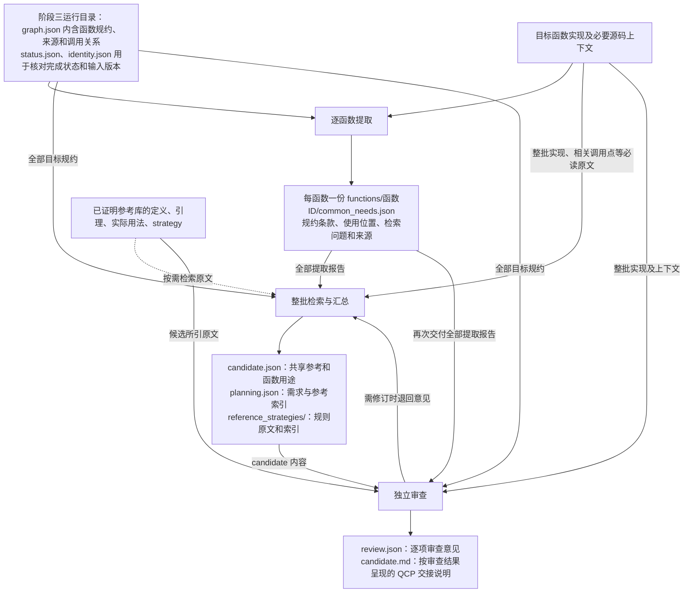

**第二轮实现**

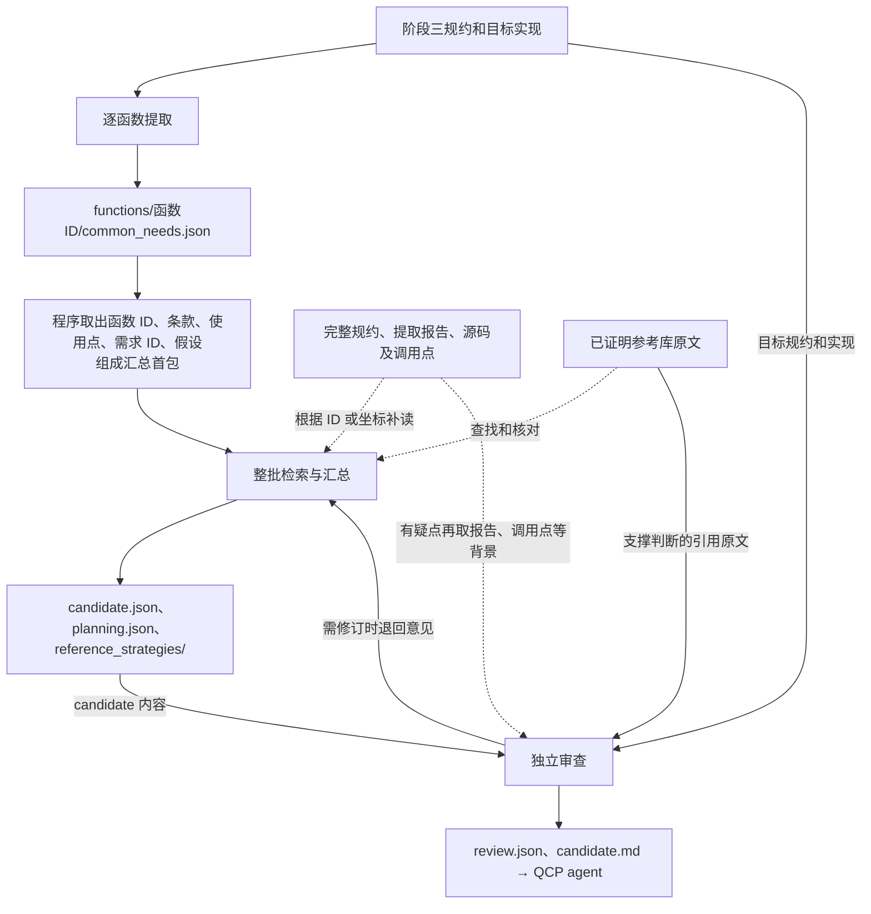

两图均省略各角色必读的规约书写规范、上游条件，以及运行恢复文件。源码包模式下，当前实现会将包内全部映射区间列入必读；第二轮保留允许读取的映射索引，按角色选择默认交付区间。审核者仍须在自己的会话中收到用于认可推荐的原文。显式输入修订要求交付的新增材料仍按修订协议处理。


**维护方式。** 开始一轮时更新其状态；完成后在本节登记实现位置、验收结果和遗留问题，并同步修订第 7 节的阶段流程、第 8 节的输入输出及状态说明，以及阶段四模板和 README。实验观察注明对应运行记录。

## 阶段编号与代码目录的对应关系

本文统一使用以下四个阶段。**代码目录和默认命令已经按四阶段划分。** `stage1/` 至 `stage4/` 分别对应阶段一至四；历史运行目录和文件内容不迁移。

| 流程阶段 | 工作内容 | 当前实现位置 |
| --- | --- | --- |
| 阶段一 | 划分和比较模块，推荐当前最适合处理的目标模块及参考模块，由用户确认 | `stage1/focused.py` |
| 阶段二 | 为选定模块构建函数依赖图，选择当前最适合处理的一批函数，并确定所需的调用者、被调用者和处理边界 | `stage2/fm_graph.py`、`inventory.py`、`select.py`、`selection_tools.py`、`demand_scope.py` |
| 阶段三 | 根据调用关系，自顶向下为本批函数生成自然语言规约，汇总多个调用者的需求，并审核规约 | `stage3/reference.py`、`reference_review.py` |
| 阶段四 | 根据本批规约和实现筛选已证明库的复用参考 | `stage4/pipeline.py`、`planning.py` |

阶段二可人工指定初始函数组，也可使用 stage2.select：同一 agent 阅读背景和实现，沿图向上提出函数组；静态工具计算新增依赖、材料大小和批次上限。结果仍等待用户确认，不保证全局最优。详见 函数组选择。

### 术语约定

| 术语 | 本文含义 |
| --- | --- |
| 函数依赖图（当前主要是调用图） | 节点是具体函数定义，边从调用者指向被调用者。当前图还记录无法确定目标的调用；不能当作完整的全程序依赖分析结果 |
| 强连通分量（SCC） | 图中相互可达的一组节点；递归或相互递归函数需要按分量组织 |
| 前置条件 / 后置条件 | 分别描述调用前必须满足的条件、返回后保证成立的性质。QCP 中包含分离逻辑的内存断言 |
| 分离逻辑的空间合取 `P * Q` | 表示两部分可分离的内存资源分别满足 P 和 Q；`emp` 表示空内存资源 |
| 函数契约 | 函数的前置条件、后置条件及相关逻辑参数；自然语言推荐规约不等于已验证契约 |
| 验证义务（proof/validation obligation） | 为确认定义、引理或适配方案可用而必须完成的检查或证明；记录义务不表示已完成 |
| 输入快照 / 内容摘要 | 输入文件的版本记录及其哈希，用于检测文件变化；不是形式化证明 |
| manifest（输入清单） | 指定模块、源文件范围、配置和参考材料来源的 JSON 文件 |
| 候选 | 已提出但尚未完成所需形式化验证的定义、引理或规约 |
| target / demand / context | 代码中的范围分类：本批处理目标、为推导需求而分析的上层调用者、仅供参考的范围外函数。详细集合见阶段二 |

## 1. 工具目标与当前能力

工具面向一个待证明库和若干个已证明参考库，通过分析待证明库的实现和参考库已有的规约、定义、引理及证明，辅助生成自然语言规约、可复用的通用定义和引理，并交给 Coq/QCP 进行验证。工具采用分阶段、按需读取、保存中间结果的方式，不是一次把所有源码交给模型完成证明。

| 能力 | 当前实现 | 不能据此声称 |
| --- | --- | --- |
| 模块划分、依赖规划、分层跨库比较 | 阶段一已实现；选择结果仍待人工确认 | 整个目标库已分析完整或已完成证明 |
| 函数图 | 默认固定版本 FM-Agent C 后端，保留配置、候选边和未知项 | 函数指针、宏和全部平台配置均已解析 |
| 函数组范围 | version=2 向下补依赖，再向上汇总需求；支持显式边界 | 图上的叶子必然没有真实依赖 |
| 自然规约 | 默认生成、独立模型审核和限制次数的修订；支持领域关注点 | 模型 pass 等于语义证明 |
| 材料准备 | 静态定位类型/宏候选；任务相关背景；自动交付必读材料；批量补读 | 已完成 C 预处理或全部递归引用的类型定义 |
| 阶段四 | 逐函数需求提取、原文追溯、复用判断和独立审核 | 已生成、编译或验证 Coq 文件 |
| 独立源码准备 | 另有提取、人工适配/确认和旧源码包流程 | 它是当前自然规约入口的必要前置步骤 |
| Coq、形式化规约、spec_check、调用检查、QCP 证明 | 有独立实验和人工协调证据；尚未接成默认完整自动链 | 整体工具已自动从模块走到证明验收 |

当前默认自动交接的终点是阶段四的复用参考和限制说明。目标证明由后续 QCP 流程负责。

### 通用输入模型与当前案例

- **待证明库：** 本轮需要分析和验证的一个软件库，包括源码、头文件、构建配置和已有需求说明。
- **已证明参考库：** 若干个可供比较和复用的软件库，每个库分别提供实现、已验证规约、定义、引理和证明材料，并记录证明覆盖范围、配置及假设。称为“已证明库”不表示其中所有模块和所有配置均已验证。
- **选择关系：** 每个目标模块可以匹配零个、一个或多个参考模块；不同目标模块不必使用同一参考库。没有适用参考时应记录结果，不能强行建立对应关系。
- **当前案例：** OpenSSL 是待证明库，SM2 和 mini-GMP 是已证明参考库。本文的 BN 命令和实验数据用于说明当前案例，不限定工具只能处理这些库或只能接收两个参考库。

**实现限制：** 当前阶段一仍将这些案例名称用于库标识校验和目标库判断，例如 stage1/contracts.py 的库集合校验、stage1/focused.py 和 focused_contracts.py 对 openssl 的判断。因此，“一个待证明库和若干个已证明参考库”是工具的通用设计；任意库集合的配置支持尚未完全实现。后续需要将目标库角色、参考库列表及材料路径改为输入配置，本次只修正文档，不修改运行逻辑。

### 整体流程

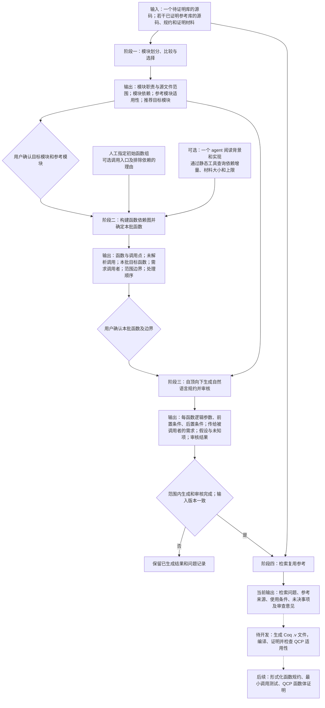

实线表示当前已有的处理或人工确认步骤；虚线表示尚未接入的执行步骤。阶段四输出参考及适用范围，后续证明按需采用。

当前 `python3 -m stage2` 只构建函数图；`python3 -m stage2.demand_scope` 计算函数范围；`python3 -m stage3` 生成自然规约，也保留 `--prepare-only` 用于生成前的静态准备。`--with-common` 在阶段三完成后调用 `stage4` 执行参考检索，不会自动开始 Coq 或 QCP 证明。

## 2. 入口与代码导航

### 2.1 当前入口和兼容入口

| 入口 | 调用实现 | 用途 |
| --- | --- | --- |
| `python3 -m stage1.multi` | `stage1/focused.py` | 当前模块分析、初筛、深读、比较和独立审核 |
| `python3 -m stage1.runner` | CLI 转到 `stage1.multi` | 兼容命令；文件内仍留有旧 runner 函数 |
| `python3 -m stage2` | `stage2/__main__.py` | 静态构建函数图，不调用模型 |
| `python3 -m stage3` | `stage3/__main__.py → reference.main` | 自然规约生成与独立审核 |
| `python3 -m stage2.select` | `stage2/select.py → selection_tools.py` | 一个模型会话读取原文并选择函数组；静态工具计算依赖、材料与上限 |
| `python3 -m stage2.demand_scope` | `stage2/demand_scope.py` | 阶段二：根据函数请求计算处理范围；不运行模型 |
| `python3 -m stage4` | `stage4/__main__.py → pipeline.run_pipeline` | 参考库检索和交接 |
| `python3 -m stage2.prepare extract / approve` | `stage2/prepare.py` | 独立源码提取与人工确认；不是默认自然规约前置步骤 |
| `python3 -m stage2.legacy_cli` | `bundles / legacy` 分支 | 兼容旧源码包、旧规约流程；不能当作当前默认入口 |
| `runs/.../native_driver.py` 等 | 单轮试验适配器 | Windows 原生子 agent 等实验接入，不是已产品化的默认后端 |

尤其注意：`stage2/pipeline.py` 仍被复用来加载 manifest，但它自己的旧流程不等于 `python -m stage3` 的当前执行流程。

### 2.2 目录职责

| 目录或文件 | 职责与维护重点 |
| --- | --- |
| `input/` | 原始库及参考材料副本；模型读取边界，不存生成结果 |
| `stage1/` | 模块分析，同时承载 Reader、任务执行器、后端、快照等公共基础设施 |
| `stage2/` | 函数索引与图、范围计划；暂保留旧源码准备流程和兼容导入 |
| `stage3/` | 自然语言规约生成、审核、领域目录与输入材料准备 |
| `stage4/` | 需求提取、共享参考、函数使用说明、审核和交接校验 |
| `templates/` | 阶段一等结构契约；不要假定所有提示都在此目录 |
| `scripts/` | 图后端环境配置、安装与静态辅助脚本 |
| `.deps/`、`.venv-graph/` | 固定的外部图分析代码和依赖环境；不要直接修改上游绕过版本检查 |
| `tests/` | 机制、协议、预算、证据、交接和兼容性测试 |
| `runs/` | 运行配置、输入快照、任务、报告、失败和实验记录；不是默认模型可浏览的答案库 |
| `TOOL_OPTIMIZATION.md` | 优化依据，包含尚未实现的目标，不作为完成清单 |
| `MATERIAL_DELIVERY.md` | 当前材料准备和读取协议 |
| `DEVELOPMENT.md` | 本文：整体架构、实现边界、改动入口与维护规则 |

### 2.3 代码结构图

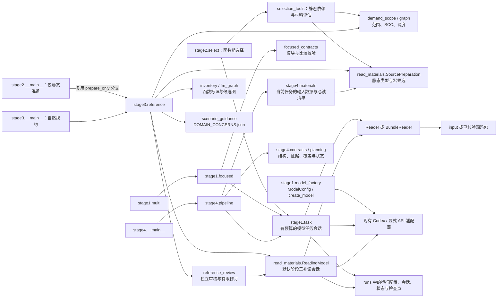

**两种执行路径不能混为一谈：**

- 阶段一、阶段二的函数组选择、阶段四和若干旧流程使用 `stage1.task.run_task`。
- 当前默认阶段三在 `reference.py` 中组织批次、格式修复与审核；`ReadingModel` 包装可选补读。它不是自动套用阶段四的 24 次角色调用预算。
- 所以修改公共执行器后，要确认当前默认入口是否真的调用它；只修改旧流程或帮助函数，不代表默认流程已经接入。

## 3. 阶段一：模块划分、比较与目标模块选择

本阶段的具体输入、输出及文件位置见 [输入输出说明](#阶段一模块划分比较与选择)。

源码依据：[focused.py](stage1/focused.py)、[focused_contracts.py](stage1/focused_contracts.py)。

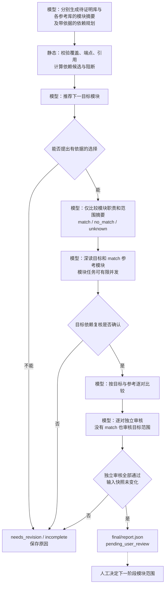

初筛任务只能读取模块摘要，不能直接绕过初筛把全库源码装进上下文。源码深读与成对比较有各自上下文。未知依赖不能被当作已解决；模块图不是完整函数调用图。

阶段一默认入口并不保证任意中断状态都能自动恢复。`continue_saved.py` 和 `run_task(resume_from=...)` 提供受控续接机制，必须核对它们各自适用条件，不能据历史专用续接脚本宣称普遍支持自动恢复。

## 4. 阶段二：函数依赖图与待处理函数选择

本阶段的具体输入、输出及文件位置见 [输入输出说明](#阶段二函数依赖图与待处理函数选择)。

### 4.1 构建函数图

源码依据：[fm_graph.py](stage2/fm_graph.py)、[fm_graph_worker.py](stage2/fm_graph_worker.py)、[inventory.py](stage2/inventory.py)。

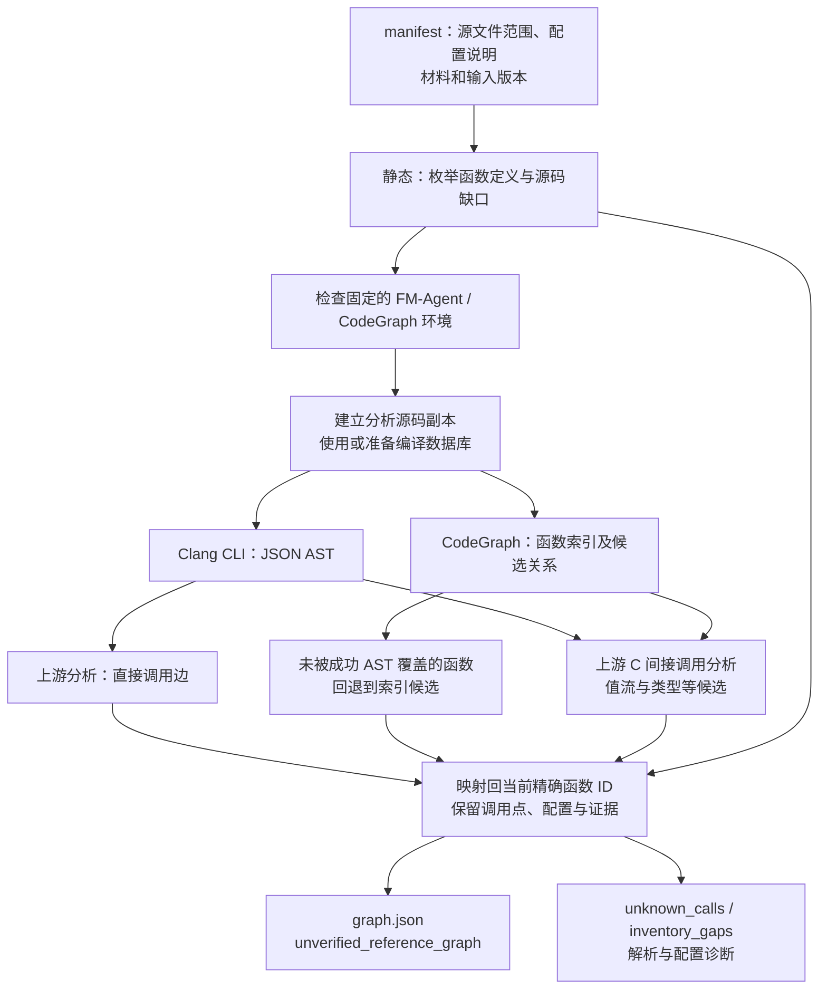

使用命令行 Clang AST，不是 Python libclang。CodeGraph 与 FM-Agent 均来自固定上游版本，具体版本与安装见 FM_AGENT_GRAPH.md。静态分析配置不是正式 QCP 证明配置。

函数 ID 区分源码位置及条件实现。函数指针目标和条件实现可能仍只是候选；AST 未覆盖、未映射的调用、宏和非 C 实现缺口必须保留。已有图的缺边不会被范围规划自动修复。本轮试验曾由监督侧补过候选边，这属于试验干预，不是图构建器已具备的能力。

`--prepare-only` 不调用规约模型，但在没有 `--scope-plan` 时可能实际构建函数图、运行静态分析工具；不能理解为完全不执行外部工具。

### 4.2 函数组选择

stage2/select.py 使用单个模型会话读取原文；selection_tools.py 提供底层候选、调用者、依赖增量、材料量与上限查询。超限和源码缺失由程序检查，未知调用和材料完整性仍保留为未知。输出 selection.json、assessment.json 及待用户确认的范围计划，不执行规约生成。详见 函数组选择。

选择器的输入是已保存的函数图、原始源码、用户指定的 README 等背景路径，以及批次和会话预算。模型只负责判断本批函数的用途及是否值得继续向上扩展；不先编写函数特性报告，不自行计算依赖数量。

| 静态查询 | 内容 |
| --- | --- |
| candidate_frontier | 按强连通分量提供底层候选及源码位置，保留未知调用 |
| direct_callers | 查询补齐依赖后函数组的直接调用者 |
| evaluate_group | 计算完整目标组、需求调用者、相对上一组的新增依赖、已定位材料大小和超限项 |
| scope_details | 分页读取成员、缺失源码、未解析调用及其他未知项 |

默认批次上限为 12 个目标函数、40 个生成范围函数、120000 个已知材料 JSON 字符；选择会话默认最多 16 次调用、900 秒、60000 字符上下文。两类预算不混用：前者用于控制批次工作量，后者约束当前模型会话。已知材料不包括未来生成的规约及尚未读取的参考内容，不能据此保证下一阶段的总 token 或证明耗时。

当前自动选择使用全部已识别上层调用需求，不自行裁剪需求入口或排除被调用依赖。若需要明确的范围边界，仍使用 demand_scope 人工请求路径。推荐规约不算已证明契约，不能据此自动扣除未处理依赖。结果必须经用户确认后进入阶段三。

### 4.3 version=2 范围规划

源码依据：[demand_scope.py](stage2/demand_scope.py)。输入是已有图和明确的函数 ID，不由该模块自动推荐一批目标。

角色定义：

| 角色 | 是否生成自然规约 | 是否进入阶段四 |
| --- | --- | --- |
| 用户指定目标 | 是 | 是 |
| 自动补入的被调用函数、同一递归分量成员 | 是，仍属 `target` | 是 |
| 向上传递需求的 `demand` 函数 | 是；当前仍生成完整规约 | 否，只提供背景 |
| `context` 边界函数 | 否 | 否，只提供背景与未解决条件 |

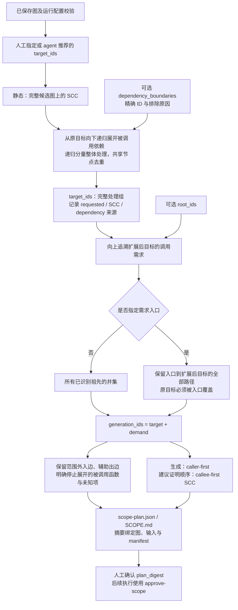

关键规则：

- 旧草稿、同名函数或模型 `review=pass` 不作为“已验证契约”自动截断依赖；当前没有自动核验契约适用性的机制。
- 明确停止展开的被调用函数按 SCC 截断，必须可达且说明理由；不能排除原目标所在分量。依赖状态仍为未解决。
- 仅 `target_ids` 向下闭合。`demand` 函数的无关辅助调用保留为边界，不无限扩展整库。
- 入口截断不表示其他调用者没有需求；它们留在边界记录中。
- SCC 内没有严格的先后关系。建议证明顺序只表示图上依赖关系，不授权执行证明。
- version=1 历史计划仍按旧的祖先路径语义校验；启用新版行为应重新规划并确认摘要。

## 5. 阶段三：自顶向下生成自然语言规约

本阶段的具体输入、输出及文件位置见 [输入输出说明](#阶段三自顶向下生成自然语言规约)。

源码依据：[reference.py](stage3/reference.py)、[reference_review.py](stage3/reference_review.py)、[scenario_guidance.py](stage3/scenario_guidance.py)。

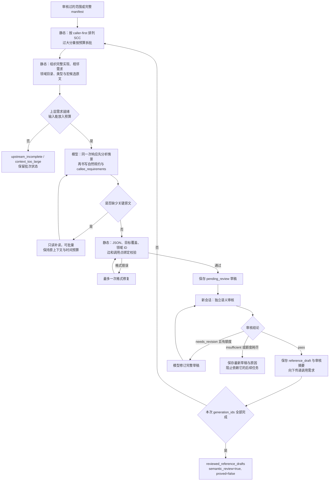

生成前情景分析在同一次生成响应内完成，**不是额外模型阶段**。`DOMAIN_CONCERNS.json` 同时维护通用要求、领域目录和关注点，程序检查结构与引用，不能据此判定分析语义正确。

规约采用职责与符号说明，以及命名规约的 `With / Require / Ensure`：

- 内存资源与数值条件共同写入前后条件，不另设独立 Memory/Modifies 分类。
- 入口快照必须绑定实际参数或资源；写入后不能把旧输入内容当成当前内存。
- 输出应可明确计算，或通过唯一结果关系与相应计算接口/等价义务连接。
- 允许 exists、析取、原地与分离契约；不能因为难证明就加强前提或缩小输入范围。
- 零长处理、资源自动匹配、C 指针和逻辑整数地址的缩放差异，仍须后续实际检查。

独立审核检查输入取值范围、精确输出、入口快照、内存资源、分支覆盖、调用需求、假设、计算接口。`insufficient` 不进入盲目语义重试；默认最多一次语义修订。格式修复与语义修订是不同额度。

显式 `--skip-review` 仍可生成未审核稿，但状态不能伪装为已审核。本节主图描述默认审核开启的路径。

## 6. 任务输入准备、读取和来源记录

源码依据：[read_materials.py](stage3/read_materials.py)、[materials.py](stage4/materials.py)、[reader.py](stage1/reader.py)、[task.py](stage1/task.py)。完整协议见 MATERIAL_DELIVERY.md。

### 6.1 当前静态准备的职责

- `SourcePreparation` 有界遍历本地 include，按词法标识符定位类型和宏候选，递归补充候选依赖，并保留宏续行及外层条件历史。
- 条件分支不求值，缺少系统/生成头文件、非字面 include、解析失败或遍历上限均保留为缺口。
- 同文件的路径和哈希分组保存；重复的缺失 include 保留全部来源后合并表示。
- 阶段四按任务筛选背景，完整相关条件仍保留，未直接放入模型输入的记录保存为可按需读取的索引。
- inventory 缺口无法可靠归属单函数，必读视图保留其全局未知影响。未展开不是已经证明无关。
- 同一会话的必读源码区间先合并去重，再分段交付。跨角色可以复用定位结果，**不能据此声称另一个模型任务已阅读或审核同一材料**。

### 6.2 任务输入准备与读取流程图

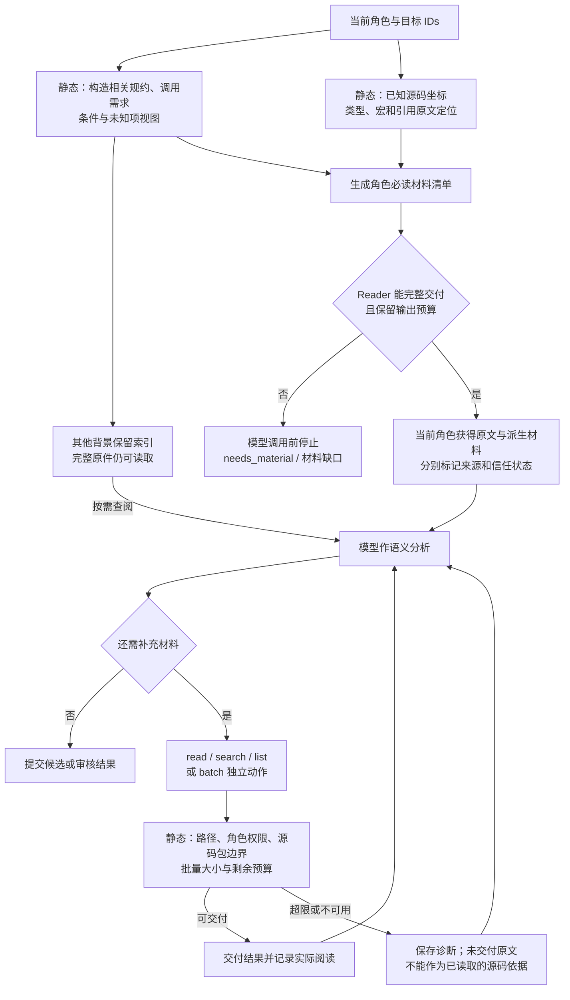

这张图主要表示 `run_task` 的阶段四必读交付路径。默认阶段三把准备好的实现和辅助原文直接放入 assignment，超限由批次预检处理；补读由 `ReadingModel` 实现。两者使用相同的原始输入边界，但状态文件布局不完全相同。

### 6.3 检索、批量读取和保存

- search 支持单文件与目录。默认 20 个命中、最多 40 个，片段最多 160 字符；连续检索使用完整 `next_action`，不能只沿用文件 offset 而漏掉同文件后续命中。
- batch 一次 1–8 个独立 read/search/list，不允许嵌套。依赖前一步结果的请求仍分开进行。
- 批次结果超过 24000 字符时整体不交付，并撤回本批新增引用依据；任务级预算还有独立检查。
- 搜索片段、源码索引、旧提取报告和模型自述都不是当前模型任务实际读取的原文。`reads.jsonl` 中存在执行记录也不必然代表交付成功，需结合会话与 withheld 记录判断。
- 默认源码包兼容输入只能用 `BundleReader` 读包内原文，不回退到完整库。
- `run_task` 的固定理解草稿频率目前仍保留；本轮材料优化没有取消它。不要把建议中的“纯程序自动检查点替代所有草稿轮次”写成已实现。

## 7. 阶段四：参考库检索与交接

阶段四读取阶段三运行目录，核对输入快照、规约完成状态、范围及审核策略。只为选定函数提取检索问题，保留相关调用者的条件。来源是一个或多个已证明参考库。上游自然规约的假设仍按其原有状态交接。

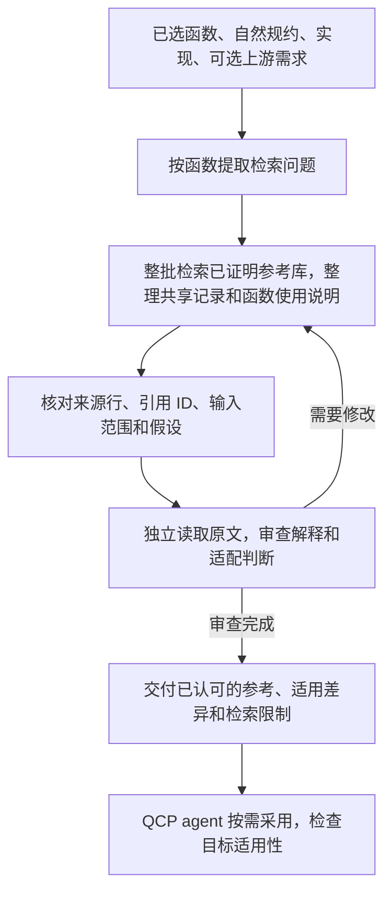

参考原文的解释出现错误时，受该错误影响的推荐都需要修订。仅某一函数用途判断错误时，修订对应的函数说明。独立审查核对方向、条件和适用范围；程序核对来源、实际交付的行和关联 ID。编译或证明目标函数属于后续工作。

选定的 strategy 通过参考 ID 关联，在 `reference_strategies/` 中导出原文及索引。证明位置未定位时，说明本次阅读范围。没有相关规则时可交付空索引。详见 [交付模板](stage4/COMMON_CONTENT_TEMPLATE.md)。

## 8. 产物、状态与恢复

### 8.1 各阶段的输入与输出

以下先描述数据的具体内容，再给出文件位置和用途。路径相对于对应步骤的输出目录；`<id>` 是函数或模块的唯一标识。“主要输出”是下一阶段需要的数据；运行配置、日志和检查点另列为辅助文件。失败或中断时不保证所有输出均已产生。

#### 阶段一：模块划分、比较与选择

**输入**

| 具体内容 | 读取位置 | 用途 |
| --- | --- | --- |
| 待证明库的函数实现、头文件、目录结构和可用说明 | `input/` 内的目标库目录 | 划分模块，分析职责和依赖 |
| 各已证明参考库的实现、规约、Coq 定义、引理、证明及说明 | `input/` 内的参考库目录 | 先比较模块职责，再阅读可能适用的参考内容 |
| 模块数量限制、模型配置、时间和上下文预算 | 命令参数 | 控制执行资源 |

**主要输出**

| 具体内容 | 保存位置 | 用途 |
| --- | --- | --- |
| 各库模块的标识、职责、源文件范围、依赖和源码依据 | `plan.json / .md` | 描述模块划分 |
| 模块间依赖关系、可推荐模块和阻碍处理的依赖 | `dependency_graph.json / .md`、`dependency_frontier.json / .md` | 支持选择当前目标模块 |
| 推荐目标模块及选择理由 | `selection.json / .md` | 提交用户决定 |
| 每个参考模块与目标模块的匹配结论及理由：适用、不适用或未知 | `screening.json / .md` | 决定详细阅读哪些参考模块 |
| 模块实现分析、依赖复核；每对模块的相似点、差异和可复用内容 | `modules/<id>.json / .md`、`comparisons/<参考模块ID>.json / .md` | 为后续函数分析提供背景 |
| 审核问题、结论、选定模块和未确定的参考关系 | `reviews/`、`final/report.json / .md` | 用户确认本轮模块选择 |

**传给阶段二：** 用户确认的目标模块与参考模块、目标源文件范围、模块说明引用、源码版本和配置说明。当前需整理为 manifest；`final/report.json` 不能直接替代 manifest。

#### 阶段二：函数依赖图与待处理函数选择

**输入**

| 具体内容 | 读取位置 | 用途 |
| --- | --- | --- |
| 选定模块的源文件范围、目标/参考模块说明引用、源码版本和配置说明 | manifest 及引用材料 | 确定分析对象 |
| C 实现、头文件、宏和可用编译命令 | 原始输入及图分析工作目录 | 枚举具体函数定义，分析调用关系 |
| 人工选择时：初始目标函数 ID，可选的上层调用入口，以及不继续展开的函数及原因 | request JSON 的 `target_ids`、`root_ids`、`dependency_boundaries` | 作为 demand_scope 的人工请求 |
| 自动选择时：背景原文的相对路径、目标数/生成范围数/已知材料量上限、当前选择会话预算 | select 的 --background、--max-*、--calls、--seconds、--context-chars | 让模型直接阅读原文，由程序计算依赖和预算；不要求预先指定目标 ID |

**主要输出**

| 具体内容 | 保存位置 | 用途 |
| --- | --- | --- |
| 函数 ID、名称、源码位置、配置或实现变体信息 | 图运行的 `graph.json` 节点及相关记录 | 唯一区分函数实现 |
| 调用者、被调用者、调用点和分析依据；无法确定目标的调用、解析失败和枚举缺口 | 同一 `graph.json` 的边、未知调用和诊断记录 | 建立函数依赖图，保留不确定性 |
| 原始请求函数，以及补入被调用依赖和递归分量后的完整目标函数组 | `scope-plan.json` 的 `requested_target_ids`、`target_ids` 等字段 | 明确本批处理对象 |
| 用于推导需求的上层调用者、仅作背景的范围外函数、跨范围调用边和明确排除的依赖 | `scope-plan.json` 及范围目录的 `graph.json` | 确定哪些调用需求需要分析、哪些依赖暂不处理 |
| 规约生成顺序、建议证明顺序、强连通分量、未知项和计划摘要 | `scope-plan.json`；可读版本 `SCOPE.md` | 安排处理顺序，供用户确认 |

自动选择还产生以下内容：

| 具体内容 | 保存位置 | 用途 |
| --- | --- | --- |
| 初始目标 ID、功能价值理由、停止扩展的原因、实际阅读的源码引用及评估标识 | selection.json | 让用户核对选择依据 |
| 完整依赖范围、数量、已定位材料大小、配置上限及缺失/未知记录 | assessment.json | 核对静态计算结果 |
| 选择任务来源、配置、工具调用和模型会话记录 | identity.json、task/、status.json | 排错与复现；不代表已完成人工确认 |

**传给阶段三：** 用户确认的函数组、相关调用者与边界、调用图及源码位置、规约生成顺序，以及阶段一模块说明。`plan_digest` 是计划内容摘要，不是正确性证明。

图运行与范围运行各有一个 `graph.json`：前者是模块分析图，后者是按本轮范围选取的图。二者均不表示自然语言规约已经生成完成。

#### 阶段三：自顶向下生成自然语言规约

**输入**

| 具体内容 | 读取位置 | 用途 |
| --- | --- | --- |
| 本批函数、需求调用者、范围边界、调用点和生成顺序 | 已确认的范围计划、函数图及 manifest | 确定生成对象和调用需求传播关系 |
| 当前函数完整实现、相关类型、宏、条件编译分支和必要调用点原文 | 原始源码及静态定位、按需读取结果 | 分析实际行为及适用配置 |
| 模块职责，以及已有调用者对当前函数的参数条件、结果要求和调用场景 | 模块说明、图中调用边的需求记录 | 汇总多个调用点需求 |
| 通用写作要求、领域关注点，以及需要时补读的参考材料 | 本轮 `writing-guidance.json`、允许读取的原文 | 先分析情景，再写规约；不默认所有参考材料已经读过 |

**主要输出**

| 具体内容 | 保存位置 | 用途 |
| --- | --- | --- |
| 适用领域、函数行为概括、边界条件、关注事项及分析依据 | `specs/<函数ID>.json` 的 `scenario_analysis`；对应 Markdown | 说明生成者如何理解函数 |
| 逻辑参数及符号含义、入口旧值、前置条件、精确后置条件、边界情况；内存资源和修改结果写在前后条件中 | `specs/<函数ID>.json / .md`，并存入生成运行的 `graph.json` 节点 | 交付自然语言推荐规约 |
| 对各被调用函数的参数条件、结果要求及调用点依据 | 规约中的 `callee_requirements`，经校验后关联到 `graph.json` 调用边 | 为被调用函数生成规约提供需求 |
| 未解析行为、缺少材料、适用配置、额外假设及尚未确认事项 | 规约和相关图记录 | 明确推荐规约的适用范围和不确定性 |
| 审核意见、修改要求、修订后的规约及逐函数审核结果 | 批次任务审核/修订记录、`graph.json`、`status.json` | 决定是否进入阶段四，不代表形式化证明通过 |

**传给阶段四：** 完整生成运行目录中的最终规约、逐调用点需求、假设与未知项、审核结论、函数范围及输入版本。阶段四用 `--stage3-run` 读取这个目录；这是当前参数名；旧参数 --stage2-run 仍可作为兼容别名。

默认需要整个生成范围完成审核，包括上层需求调用者。阶段四仅为 `target_ids` 提取公共需求，上层调用者规约仍是背景。显式跳过审核时必须保留“未审核”状态。

#### 阶段四：参考库检索与交接

| 输入内容 | 来源 |
|---|---|
| 目标函数的推荐规约、实现、配置、调用关系、条件和审核结果 | 阶段三运行目录及其记录的输入 |
| 已证明库的定义、引理、表示、实际使用位置和相关 strategy | 输入目录或批准的源码包 |

| 输出内容 | 文件 |
|---|---|
| 已有上游需求及本轮按规约和使用点提取的检索问题 | `functions/<函数ID>/common_needs.json` |
| 共享参考及各函数的使用说明、检索范围、差异和未知条件 | `candidate.json`、`planning.json` |
| 可交付的推荐、审查意见和目标端待确认事项 | `review.json`、`candidate.md` |
| 引用的 strategy 原文、原始坐标和摘要 | `reference_strategies/` |
| 运行状态、恢复所需记录和人读摘要 | `status.json`、`checkpoint.json`、`SUMMARY.md` |

#### 独立源码准备：不是上述阶段的必经步骤

| 类型 | 具体内容 | 文件位置 |
| --- | --- | --- |
| 输入 | 函数实现、必要类型和宏、callee 声明、可选的匹配契约 | 原始输入、manifest 和显式传入的契约 |
| 提取输出 | 每函数一个 C 文件，包含实现、声明和可用规约；另记录来源位置、覆盖范围、缺失内容及人工修改 | `<函数ID>.c`、`preparation.json`、`REVIEW.md` |
| 人工审核后输出 | 修改并确认的 C 文件、文件哈希、源码映射、配置和审核记录 | `<函数ID>.c`、`prepared.json` |

`stage2.prepare approve` 只保存已填写的审核记录，不代替人工审核、编译或等价性证明。

#### 辅助文件：版本、状态和运行记录

| 具体内容 | 文件位置 | 用途 |
| --- | --- | --- |
| 输入文件版本、模型参数、提示与策略版本、内容摘要 | `input_snapshot.json`、`identity.json`（按入口保存） | 防止混用不同配置或源码版本的结果 |
| 本轮写作要求 | `writing-guidance.json` | 保证生成与修订采用相同规则 |
| 上游来源、审核情况、函数范围和适用条件 | 阶段四的 `upstream_context.json`、`upstream_conditions.json` | 保留上游结果的条件与验证状态 |
| 模型实际收到的输入、响应、源码读取记录和失败原因 | `tasks/`、`material-sessions/` 等任务目录 | 重现判断依据；不同执行器的日志布局不同 |
| 必须提供的原文清单、缺少的材料、因预算不足而未发送的内容 | `required_inputs.json`、`material_gap.json`、`withheld-feedback-*` | 解释材料不足；未发送原文不能计为已阅读 |
| 已完成任务、当前结果和中断位置 | `status.json`、`checkpoint.json` 或 `checkpoints/` | 控制恢复；文件存在不等于执行成功 |

`run_task` 的 `report.json` 表示通过对应角色的输出校验，不自动表示语义正确。当前范围协议与通用定义规划协议均为 version=2，材料准备策略为 version=1；具体版本以代码和运行记录为准。

### 各阶段的数据传递


### 8.2 状态不能混读

| 状态或标记 | 意义 |
| --- | --- |
| `task_completed` | 某个角色输出通过对应结构/证据校验，不自动等于语义审核通过 |
| `pending_user_review` | 模块或函数组结果等待人工确认；选择器不会自动启动阶段三 |
| `selection_unavailable` | 本次选择会话未提出合适批次；不代表整个模块不存在可处理函数组 |
| `reference_draft` | 单函数参考稿；是否审核需核对其审核报告与总体策略 |
| `reviewed_reference_drafts` | 默认阶段三本批全部函数的模型审核通过；`proved=false` |
| `drafts_generated` | 显式未审核流程的本批全部函数生成完成 |
| `common_candidates_reviewed` | 保留兼容状态名，表示本批参考判断获独立审查认可；目标端适配仍待验证 |
| `needs_material` | 当前必需材料不可得或无法在预算内交付 |
| `review_insufficient` / `review_needs_revision` | 自然规约材料不足或语义修订未完成 |
| `incomplete` / `interrupted` / `failed` | 工作未完成；查看具体任务 reason，不概括成 OOM |
| `not_proved` / `not_started` | 分别表示未证明、验证执行尚未开始 |

### 8.3 恢复与返工边界

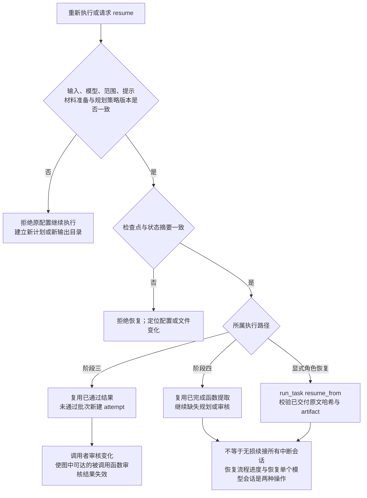

阶段四停止任务可通过 --recover-from 在新目录修复并重新校验；这不等于跨计划复用或输入迁移。跨计划自动复用旧规约、精准语义失效分析、递归分量固定点协调尚未实现。不得手工把失败状态改成 pass 来恢复。

## 9. 后续形式化与反馈应落在哪一步

以下是开发方向与实验教训，不是当前默认自动链：

| 发现的问题 | 应返回的位置 | 不应采取的做法 |
| --- | --- | --- |
| 调用边遗漏、配置候选不全 | 函数图/范围规划 | 把未知当叶子 |
| 宏、类型、副作用或调用背景缺失 | 材料准备/需求分析 | 直接增加前置条件掩盖 |
| 输入取值范围被缩小、输出不精确 | 自然规约生成与审核 | 用函数体证明通过替代域合理性检查 |
| 数学表示或参考适配不合适 | 阶段四需求、参考和复用选择 | 预设特定证明算法强行套用 |
| C 指针与整数地址偏移单位混淆 | 形式化规约生成和 spec_check | 因“证明通过”而接受过强地址条件 |
| 零长/别名契约无法被调用 | 最小调用测试及规约表达 | 宣称 QCP 普遍不支持析取 |
| Coq 可编译但 QCP 不能使用 | 通用定义和引理环境与实际使用检查 | 将编译当作集成验收 |
| 证明失败或义务改变 | 对应规约、公共定义、实现适配步骤 | 弱化结论、无依据加强前提、修改封存验收 |

建议未来链路为：参考规约及调用者阅读 → 候选形式化规约 → 语义和边界检查 → 最小调用测试 → 固定规约 → 完整证明。规约变化后记录差异与受影响义务，复用不受影响内容仍需最终一致性检查。QCP 的 auto_proof 由 QCP 自身流程负责，不额外重复审查。

## 10. 操作入口：静态准备与真实模型运行分开

以下是命令模板，不代表本文整理过程中执行了这些模型任务。输出目录必须是新的；示例使用现有 BN manifest，其输入哈希和材料适用性仍应核对。

### 10.1 图准备与函数组选择

已有图可以直接跳过第一条：

```bash
python3 -m stage2 \
  --manifest stage2/manifests/openssl-bn-module.json \
  --output runs/new-bn-graph --prepare-only

python3 -m stage2.demand_scope \
  --input input --graph-run runs/new-bn-graph \
  --request path/to/request.json --output runs/new-bn-scope
```

`request.json` 示例：

```json
{
  "target_ids": ["从 graph.json 读取的确切函数ID"],
  "root_ids": ["从 graph.json 读取的需求入口ID"],
  "dependency_boundaries": []
}
```

省略 `root_ids` 表示追溯全部已识别祖先；不能用空数组表达没有需求。若只希望从目标自身开始，可明确将入口设为目标 IDs，其他调用者会记录为范围边界。不能用裸函数名代替 ID。

也可用自动选择替代手写 request 的步骤。**以下命令会调用模型**；background 应替换为 input 内实际的待证明库背景文件路径：

```bash
python3 -m stage2.select \
  --input input --graph-run runs/new-bn-graph \
  --background target-library/README.md \
  --output runs/new-bn-scope \
  --max-targets 12 --max-generation 40 --max-material-chars 120000 \
  --calls 16 --seconds 900 --context-chars 60000
```

两条选择路径只选其一，输出目录必须不存在。自动选择也生成同格式 scope-plan.json；检查 selection.json、assessment.json 和 SCOPE.md 后，再批准其 plan_digest。它不自动继续生成规约。

先检查材料和范围，不调用模型：

```bash
python3 -m stage3 \
  --manifest stage2/manifests/openssl-bn-module.json \
  --scope-plan runs/new-bn-scope/scope-plan.json \
  --output runs/new-bn-specs --prepare-only
```

### 10.2 确认范围后运行模型

```bash
python3 -m stage3 \
  --manifest stage2/manifests/openssl-bn-module.json \
  --scope-plan runs/new-bn-scope/scope-plan.json \
  --approve-scope PLAN_DIGEST_FROM_SCOPE_PLAN \
  --output runs/new-bn-specs --resume \
  --model gpt-6.1-sol --reasoning-effort high

python3 -m stage4 \
  --stage3-run runs/new-bn-specs \
  --output runs/new-bn-common \
  --model gpt-6.1-sol --reasoning-effort high
```

也可以给阶段三加 `--with-common --common-output runs/new-bn-common`。阶段三和阶段四预算不同，自动交接不把阶段三所有预算参数直接传入阶段四。

| 当前默认预算 | 阶段三 reference | 阶段四角色任务 |
| --- | --- | --- |
| 应用层上下文 | 60000 字符 | 60000 字符 |
| 单次调用超时 | 600 秒；补读共享本次 exchange 剩余时间 | 600 秒，且受任务剩余时间及预留限制 |
| 补读/调用额度 | 单个模型任务会话最多 8 轮补读后提交结果；格式/语义修复另有边界 | 每任务默认 24 次模型调用 |
| 总任务时间 | 不是阶段四式 1800 秒角色预算 | 默认 1800 秒 |
| 语义修订 | 默认 1 次 | 默认 1 次 |
| 报告限制 | 受上下文及输出预留约束 | 候选最多 24000 字符；仍受总预算约束 |

字符数不是计费 token。新增材料可能使必读预检超限；优先拆分任务或减少重复材料，不静默截断原文，不用无上限参数掩盖结构问题。

### 10.3 后端与环境

默认 CLI 使用 `stage1/codex_backend.py`，要求适用的 Linux/WSL、Codex CLI 登录及 bubblewrap 环境；环境以实际预检为准，历史“登录成功”不是当前可用性保证。图后端另有 `scripts/setup_graph.sh`、固定上游及依赖环境。

Windows Codex 原生子 agent 的试验适配器采用任务输入约束和 Reader，不等同于默认后端的操作系统隔离。不要混写两种隔离保证，不复制凭据，不因容量/认证错误反复重试，也不自行重启 WSL。

## 11. 修改代码时从哪里开始

| 修改内容 | 首要代码 | 应检查的联动 |
| --- | --- | --- |
| 函数图、调用点、条件实现 | `stage2/fm_graph.py`、`fm_graph_worker.py`、`inventory.py` | 精确 ID、未知记录、来源与版本、范围计划失效 |
| 上下游范围和边界 | `stage2/demand_scope.py` | project、caller-first、阶段四 target 覆盖、v1 兼容 |
| 情景分析、领域要求 | `stage3/scenario_guidance.py`、`DOMAIN_CONCERNS.json` | 目录摘要、修订输出、审核字段、旧运行恢复 |
| 自然规约与审核 | `reference.py`、`reference_review.py` | 模板、caller 要求、pass 门槛、被调用函数结果失效 |
| 静态类型/宏材料 | `read_materials.py`、`macro_units.py` | 条件历史、源坐标、预算、独立审核实际接收 |
| 当前任务的背景数据与必读清单 | `stage4/materials.py`、`stage2/required_inputs.py` | 两者所在流程不同；不能只改旧入口帮助函数 |
| Reader/批量/预算/恢复 | `stage1/reader.py`、`task.py`、`stage2/bundle_reader.py` | 未交付证据回滚、权限、源码包、会话恢复 |
| 阶段四字段与候选 | `stage4/prompts.py`、`contracts.py`、`planning.py` | 需求来源、共享参考与使用说明、独立审查和版本绑定 |
| 后端或原生会话适配 | `stage1/codex_backend.py`；明确选定的适配器 | 隔离、预算、运行配置、失败分类；不要直接提升实验脚本为默认 |

一次改动至少回答：

- 默认入口是否真正经过新代码？
- 新字段由谁产生、谁消费、谁校验、存在哪里？
- 是否改变源材料范围、输入取值范围、证明责任或实际引用依据？
- 新策略如何影响运行配置摘要和旧运行恢复？
- 回归测试证明的是机制还是语义？是否需要新的真实试运行？

## 12. 测试、实验和待办

### 测试入口

```bash
python3 -m unittest tests.test_function_selection tests.test_stage_layout tests.test_demand_scope
python3 -m unittest tests.test_material_delivery tests.test_required_inputs
python3 -m unittest tests.test_reference_specs tests.test_reference_review
python3 -m unittest tests.test_stage3 tests.test_reference_stage3 tests.test_stage3_planning
python3 -m unittest tests.test_stage4_acceptance tests.test_reference_strategies
python3 -m unittest discover -s tests
```

2026-10-30 函数组选择功能回归记录为 377 项、374 项通过、3 项跳过。覆盖共享依赖去重、递归分量、未知调用、上层需求预算、材料缺失、范围计划加载和入口兼容。它是日期限定的开发记录，不是永久测试总数；新增测试后应更新记录。静态检查和测试替身通过不能代替真实模型结果、Coq 编译、QCP 调用或函数体证明。

本次材料优化的 `bn_sub_words` 静态预检：背景约 61330 → 19734 字符，21 项必读材料全部交付，首次请求约 45118 字符，可放入默认 60000 字符预算并保留输出空间。没有调用真实模型，不能据此声称已节省同等比例的 token 或总时间。

### 尚未实现或尚未验证

1. 图构建器仍可能漏直接调用、条件实现或间接目标；范围展开不能弥补缺边。
2. 背景调用者仍生成完整规约，尚未改为仅分析调用需求。
3. 阶段四仍逐函数提取，再汇总本批函数需求；未实现小组联合提取和自动语义去重。
4. 参考库通用语义索引、自动充分性判定、跨运行公共库管理尚未实现。
5. 已验证 callee 契约的自动适用性匹配及据此截断依赖尚未实现。
6. 跨计划规约复用、精确增量失效和 SCC 固定点协调尚未实现。
7. 固定频率草稿、控制 agent 逐次交接等成本问题尚未全部解决。
8. Coq 生成执行、形式化规约及 spec_check、最小调用测试和正式证明交接仍需接入。
9. 本轮模型审核曾接受 `BN_uadd` 的输入范围收缩；不能将 pass 当作原域保持的保证。
10. 上述后续工作不能通过弱化结论、增加无依据前提或改验收文件来“跑通”。


## 目录清理（2026-11-11）

工具保留四阶段程序、运行模板、回归测试、当前输入库和构图依赖。历史运行、临时目录、导出包及旧计划文档已清理。int 版单纯形的 296 个源文件集中保存到 examples/simplex-int，含必要头文件和 strategy；复制时逐文件核对 SHA-256。后续实验从新的 runs 目录开始，历史测试计数只作为当时的记录。
