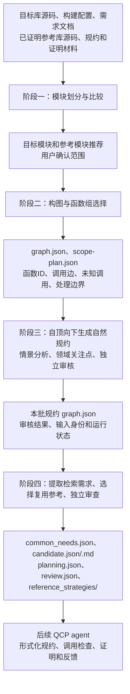
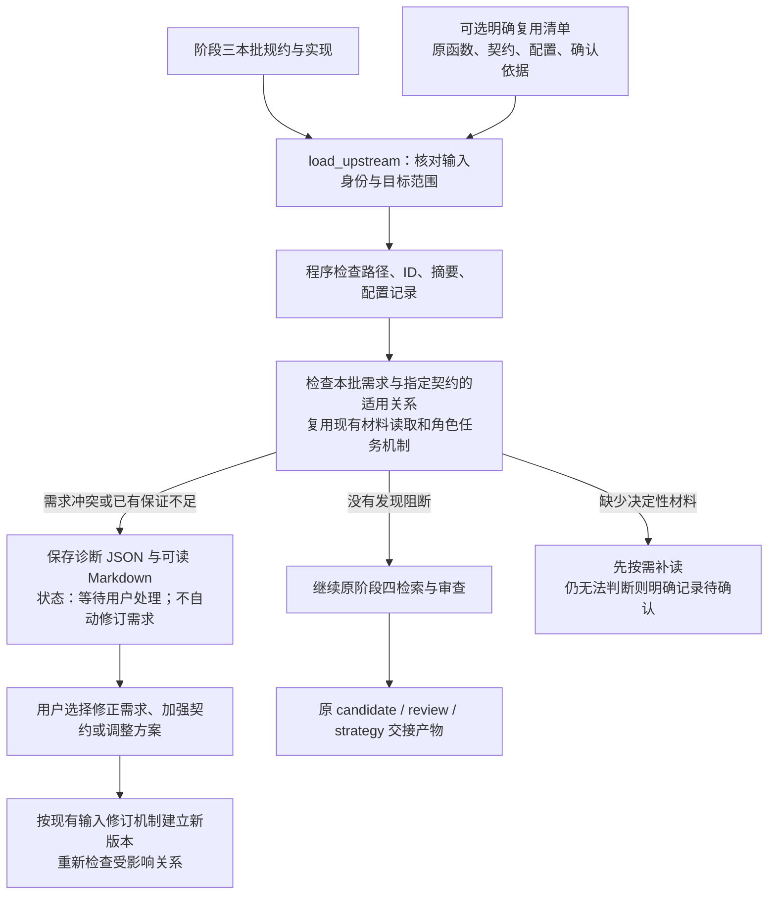

# spec-tool 优化问题与开发交接

日期：2026-11-17。本文用于切换窗口后的开发交接；本次只整理文档，没有实施下列功能，也没有启动新模型实验。后续维护入口仍是 DEVELOPMENT.md。

## 1. 下一轮先做什么

优先实现：**阶段四识别明确要求复用的函数，核对其已有契约是否能够支持本批自然语言规约；发现冲突或保证不足时，暂停并向用户交付诊断。**

不要重新把阶段四变成目标证明基础的完整设计器。普通参考中的缺口仍可以作为限制交付；只有明确指定复用的契约关系才进入这项检查。先完成一个端到端的小改动，再讨论其余优化。

本文件区分三类信息：实验中已观察到的现象、当前代码/开发指南记录的能力、建议新增的协议。下面的新字段、文件名和状态名均为设计建议，不是现有接口。

## 2. 当前流程及已有实现

工具面向一个待证明库与若干已证明参考库，不限于 OpenSSL、SM2 或 mini-GMP。



关键入口：

| 工作 | 当前代码 |
| --- | --- |
| 模块比较 | `stage1/focused.py` |
| 函数图及范围 | `stage2/fm_graph.py`、`inventory.py`、`select.py`、`selection_tools.py`、`demand_scope.py` |
| 自然规约与审核 | `stage3/reference.py`、`reference_review.py`、`scenario_guidance.py`、`DOMAIN_CONCERNS.json` |
| 阶段四输入、执行和交接 | `stage4/pipeline.py`、`materials.py`、`prompts.py`、`contracts.py`、`planning.py` |
| 分项审查、恢复、输入修订 | `stage4/components.py`、`recovery.py`、`input_revision.py` |
| strategy 附件、阅读成本 | `stage4/strategies.py`、`read_cost.py` |

阶段四已完成的两轮改造，不要作为新功能再做一次：

- 需求是检索方向；没找到参考不要求自动补齐目标证明。
- 共享参考记录与逐函数用途分开，保留原文、前提、适配差异和未知项。
- 审查重点是引用和复用判断，不以目标证明基础是否完整作为全部交付门槛。
- 汇总首包采用需求简表，完整材料按需读；审查者仍须实际收到支持结论的原文。
- 已有恢复、输入修订、分项审查及 strategy 附件机制。首次追加参考材料也已有实现。

开发指南记录第二轮固定测试共 418 项，415 通过、3 跳过。这是历史验收，不是本次重新测试结果。普通目录样例减少了全程请求字符，但源码包样例多一次调用、全程字符反而增加约 2.1%；不能宣称已经稳定降低真实 token 成本。

## 3. 实验究竟暴露了什么

### 3.1 “内部表示精确保持”首先是输入要求问题

旧 INPUT_CONTRACT 曾要求输入节点、系数头及有效 limb 内容保持不变，后续自然规约据此形成了较强的保持要求。不能把忠实传播该要求直接判为阶段三生成错误。

当前用户已确认的要求是：**归还输入对象、数学值及可清理的资源；不要求内部 limb 地址、容量和具体表示与入口快照相同。** 不允许拥有资源的输入共享。正常返回时保持精确的可满足性判定：0 表示有理数域可满足，1 表示不可满足。终止性没有额外纳入本轮要求。

例子：mini-GMP 的 `mpz_set` 在 `store_Z` 层表达来源值和目标值。即使其实际代码没有修改来源对象内部地址，该契约本身也未必公开这一等式。调用者若要求 `ptr_after = ptr_before`，不能仅由 `store_Z` 契约推出。这里是**已有保证不足以推出新增要求**，不是断言参考证明错误，也不是断言程序一定重新分配了来源对象。

值得增加的是阶段四的提前诊断，而不是让工具自动删除输入要求。用户可以选择修正需求、另做加强契约的证明或改变实现/复用方案；工具不替用户选择。

### 3.2 普通参考与必须复用未充分区分

数学引理可以只借鉴思路；指定原样复用的函数则是调用链中的既定契约边界。两者混在同一份推荐中，会把前者的适配余地错误地用于后者。

用户对复用函数的定义：**函数名称完全相同，代码语义完全相同。** 实现上不能把同名、同文本、AST 相似等同于已经证明语义一致。宏、类型宽度、编译条件、依赖和外部状态都可能改变语义。先由显式配置指定复用关系，程序核对可核对的版本、源码和构建条件；存在改写时记录依据，无法确认则标记待确认。

不需要开发通用程序等价证明器。第一版以明确声明和证据为入口，不自动把所有同名函数纳入强制复用。

### 3.3 前端通过与入口全部依赖完成曾被混淆

此前统计的 8 个前端函数不能直接代表入口可达的全部自定义函数已证明。MiniGMP 及其已有证明覆盖内的 callee 可以复用；自定义包装、内存管理等函数仍须单列。

当前开发指南明确记录：已验证 callee 契约的自动匹配、据此截断依赖尚未实现。下一轮可先保留此限制，不同时重做阶段二。后续应按准确函数 ID 列出：本轮需证明、已证明复用、外部假设、未知依赖，并绑定证据和配置。

### 3.4 函数体证明与实际调用要分别记录

`bn_sub_words` 曾出现零长函数体分支通过，但实际零长度调用匹配失败。不能归纳为 QCP 不支持析取。mini-GMP 的统一数组谓词与空数组引理是可验证的参考方案，不是可机械固化的规则。

参考阅读要包含相关定义、边界引理和实际调用者。目标端最小调用检查应在大量证明之前做，但属于后续形式化/QCP 流程，不能让阶段四偷偷启动完整证明。

### 3.5 平台及工具链版本需要绑定，不能从编译成功外推

32 位契约和参考证明不能自动视为覆盖 WSL 原生 64 位。此前 64 位最小实验还暴露了前端类型映射与具体实现常量问题，不能概括为“只改 rules 一定足够”。

此次新 QCP agent 还要求版本绑定的基础库指纹；旧 QCP 不匹配。更换为官方 QCP-V2.1.2 后已通过审计和链表回归，但参考依赖编译被用户要求暂停，尚未完成新环境顶层定义复编译。具体状态见第 8 节。这个问题是证明环境的适配事项，不应变成阶段四替所有用户安装 QCP 的职责。

## 4. 第一批修改：明确复用关系与冲突诊断

### 4.1 建议输入

为阶段四提供显式复用清单。优先复用现有 manifest 和 input-transition；确需新增选项时，再增加一个可选 JSON 路径。旧运行未提供清单时保留原行为。

每项记录至少包括：

| 内容 | 用途 |
| --- | --- |
| 稳定条目 ID、目标函数 ID、参考函数 ID、双方函数名 | 精确定位，避免仅按裸函数名匹配 |
| 目标与参考实现的路径、源码摘要及选定配置 | 约束复用的实际版本 |
| 已有契约的路径、区间、命名规约及摘要 | 明确使用哪份保证，而非模型重新猜契约 |
| 复用模式：明确要求复用 / 普通参考 | 决定是否触发暂停检查 |
| 等同性确认依据、确认状态 | 区分已确认的原函数与尚待核实的适配函数 |
| 已证明材料的来源和配置 | 追溯所复用的既有结果，不要求本阶段重证参考库 |

文件存在、摘要、区间、函数名和 ID 由程序检查。任意语义等价及契约蕴含不是静态字符串检查可以判定的事项。

### 4.2 在现有流程中的位置



实现取舍：不要默认每个函数再开一轮大型模型审核。先过滤到本批实际涉及的强制复用条目，将兼容性判断并入合适的现有任务，或只增加一次按需的整批预检。必须保证发现阻断时停止后续昂贵任务。具体落点须检查 pipeline 当前任务顺序后确定。

### 4.3 诊断要交付什么

建议新增 `reuse_diagnostics.json` 和 `REUSE_DIAGNOSTICS.md`（名字可按现有规范调整），至少包含：

- 哪条复用关系、哪个目标函数、哪条自然规约受到影响。
- 目标要求原文位置与已有契约原文位置，相关定义和配置。
- 问题类别：前提无法满足、输出/保持保证不足、配置不同、等同性未确认、决定性材料缺失。
- 解释具体无法推出哪一步，不把“暂不能推出”写成“数学上不可能”。
- 可选方案及影响；方案尚未验证时明确标注。
- 当前输入/规约/契约摘要，方便修订后判断诊断是否过期。

例子：目标要求入口 limb 地址保持，指定的 `mpz_set` 契约只归还相同数学值的 `store_Z`。诊断说明信息被抽象隐藏，并列出“用户放宽表示保持要求”“另外证明更强契约”等选择。不得自动改掉自然规约，不得修改参考库原证明。

运行状态与审查结论分开：等待用户处理不是模型连接错误，也不是参考库未证明。建议增加专门状态；具体名称及退出码应服从现有 CLI 约定。恢复后保留旧诊断历史，当前摘要不能残留已解决的阻断原因。

### 4.4 最小验收，不依赖真实模型或完整证明

| 输入情景 | 应观察到的结果 |
| --- | --- |
| 未指定强制复用 | 原阶段四行为不变；普通参考没覆盖某需求不会新增全局阻断 |
| 已确认复用，契约满足要求 | 记录检查结论，继续检索与交接；不宣称目标已证明 |
| `store_Z` 不公开内部地址，而需求要求地址精确保持 | 定位具体需求和契约，写出诊断，停止后续任务；上游文件不变 |
| 同名但配置/源码不同 | 不自动认定原函数复用；记录差异和确认缺口 |
| 源文件、契约摘要不一致 | 程序在模型调用前拒绝使用过期条目 |
| 相关定义未读 | 按现有 Reader 补读；未拿到依据时不得给出确定兼容结论 |
| 用户通过 input-transition 修改需求或补充依据 | 新输入有记录，重查受影响结论；旧通过状态不能直接继承 |
| 中途失败后恢复 | 复用有效已读材料和已完成记录；报告区分历史故障和当前冲突 |

固定响应测试只能证明路由、记录、阻断和恢复机制，不能证明模型一定能正确判断所有契约。第一版完成后再由用户决定是否做小规模真实实验。

## 5. 后续优化顺序，不在第一批同时实施

1. **依赖覆盖清单。** 在阶段二范围计划中显式列出复用边界及自定义后端，交接/报告按入口依赖核对完成范围。不要用“函数名相同”自动递归免证所有 callee。
2. **规约变化追溯。** 输入要求改变时记录受影响模块说明、阶段三规约、阶段四判断及 QCP 契约；结合现有输入身份和失效机制做保守处理，不假装已有精确语义影响分析。
3. **QCP 交接预检。** 打包时检查顶层声明能被前端解析、引用定义可导入、架构和工具链版本匹配。与证明执行保持分层；auto_proof 仍由选定 QCP agent 的流程负责。
4. **实际调用测试接口。** 正长度、零长度、别名和返回资源分别记录，函数体通过不替代调用成功。
5. **真实成本优化。** 用已有 read_cost 和会话日志定位重复阅读；先判断是否值得按共享表示联合提取，再实现。不要重写已完成的第二轮首包优化，也不要只靠提高预算。

## 6. 开发边界与需要作出的决定

已确定：参考库是已证明参考；不在阶段四重复证明其可靠性；明确复用与普通参考分开；发现需求冲突/保证不足向用户报告；不自动弱化规约；暂不开发通用 strategy 自动提取或全程序等价证明。

实现者可自行选择与现有架构一致的字段名、状态名和可选 CLI 入口，不必为命名反复请求许可。以下实质选择需要在开发说明中明确：

- 显式复用关系如何获得用户确认，哪些静态证据可自动接受，哪些只能标为待确认。
- 部分关系材料不足时，如何阻止把依赖它的结果标为可交接，同时保留已完成结果。
- 如何接入现有分项审查、修复和输入修订，避免出现两套互相冲突的状态机。

先阅读代码确认是否已有部分实现；若有，补缺口，不平行新建重复协议。

## 7. 新窗口操作要求

先读根目录 AGENTS.md、DEVELOPMENT.md、本文件、stage4/README.md 和 COMMON_CONTENT_TEMPLATE.md，再读涉及的代码与测试。需要生成/审核规约时读取根目录 SPECIFICATION_WRITING_GUIDE.md；交接 QCP 时同时读取 QCP_STRATEGY_GUIDE.md。

本轮开始前工作区已有未提交改动，包括 AGENTS.md、DEVELOPMENT.md、README.md、stage4/README.md、stage4/pipeline.py、tests/test_stage4_acceptance.py，以及新增的 strategy 指南和首次输入修订测试。不要 reset、覆盖或当作本轮新改动；先看 git diff 确认归属。本交接只新增文档、开发指南索引及隔离环境暂停记录。

不要读取全部历史日志或全部证明文件。具体实验事实优先读取相应小报告和原契约；不要修改封存实验结果。不要自动启动模型证明、重启 WSL、提交 Git 或推送。用户要求使用子 agent 时遵照其模型偏好并按任务拆分上下文；本交接不授权自动新建聊天窗口。

## 8. 暂停的 QCP 环境检查，独立于 spec-tool 开发

位置：`runs/isolated-simplex-agent-eval-20261117-01`。

已经完成：

- 使用正确的 `pv_qcp-main.zip`；错误的优化版 Simplex 包未作为输入。
- 官方 QCP-V2.1.2 归档校验通过，SHA-256：`386311c5d3891ac87a9db1347a68697f03f905b2ca48819f0998edb2bd8c18fb`。
- 新基础库 core 编译通过；新 agent audit 通过。
- 隔离环境内自带 SLL 案例 check 与 release 通过，release 状态 `local_verified`；这是工具回归，不是新 Simplex 证明，也不是在线提交。
- 顶层 contract 的导入路径与 Extern 类型声明已修正，QCP 解析通过，Require/Ensure 内容未改变。
- 官方归档 2607 个相关源码文件摘要均一致；未修改审计配置或公理允许列表。

暂停时未完成：GmpDiv 等剩余参考依赖的完整编译、新工具链下 TopSpec.v 复编译、最终环境报告和可用性收尾。正在执行的 make/coqc 已因用户暂停指令停止，已编译成功的文件保留。原先状态为基础审计阻断的记录属于历史，不能继续当作当前阻断。

原工具链保存在同级 `isolated-simplex-agent-eval-20261117-01-previous-qcp`，位于新 agent 沙箱之外。新 QCP 使用 `qcp-v2.1.2/`。后续恢复时从已有 make 目标继续，不重启 WSL，不从头重跑已通过的 SLL 回归，除非相关输入发生变化。新窗口进行 spec-tool 开发时，不自动恢复这项检查。

## 9. 可复制的新窗口提示词

```text
请接手 /home/maxu/Projects/library-spec-tool 的优化开发。先检查适用的 AGENTS.md，再阅读根目录 SPEC_TOOL_OPTIMIZATION_HANDOFF.md、DEVELOPMENT.md、stage4/README.md、stage4/COMMON_CONTENT_TEMPLATE.md 及相关代码和测试。

本轮优先落地交接文档第 4 节：阶段四区分普通参考与明确要求复用的函数契约，检查本批自然规约与指定契约的适用关系；发现冲突、保证不足或决定性依据缺失时保存具体诊断，并停止依赖该判断的后续工作，交给用户选择处理方案。不要自动修改上游需求或参考证明。

复用函数要求名称相同且代码语义相同，但同名、哈希或 AST 相似不能单独证明语义一致。第一版采用显式复用关系与可追溯的确认依据，不开发通用等价证明器。参考库已经证明，阶段四不承担重证参考库和补齐目标完整证明基础的工作。

先核实哪些能力已有实现，再给出字段、数据流、状态及测试的简短具体计划，然后实施最小改动，运行相关测试，并同步 DEVELOPMENT.md 和必要的阶段四文档。无强制复用清单时保持原流程；普通参考缺口不因此全局失败。保护现有未提交改动。测试报告区分程序机制验收和模型语义判断。

本轮不启动真实模型实验或 QCP 证明，不恢复已暂停的 QCP 环境检查，不重启 WSL，不提交或推送 Git。更大范围的依赖覆盖、形式化调用测试和阅读成本优化先保留为后续事项。
```
