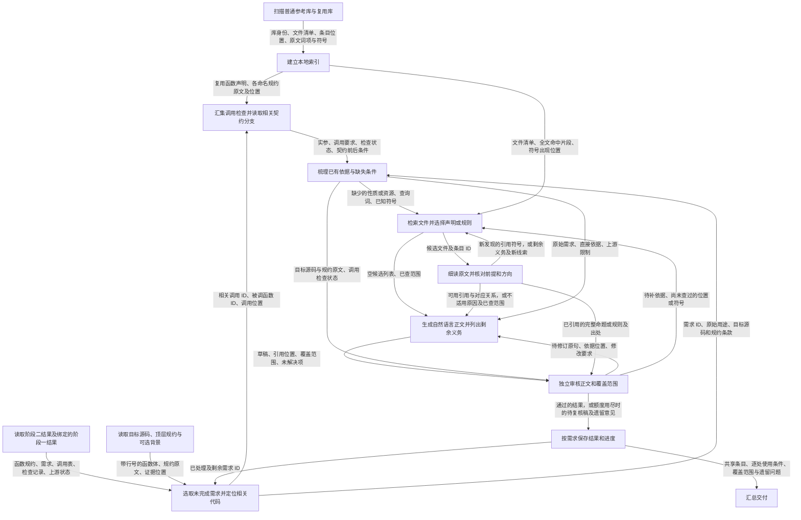

# 阶段三开发方案：参考检索与公共内容生成

阶段三读取阶段二的自然语言规约和公共内容需求，找出能支持具体证明步骤的参考，并形成待验证的公共定义、引理和 QCP strategy。本文是开发方案。文中的字段与接口用于实现及评审，验收后将实际接口写入 [程序需求与接口](PROGRAM_REQUIREMENTS.md)。

## 1 首版范围

**阶段三面向用户提供的任意待证明库和参考库。** OpenSSL、Minimal Simplex 及其参考材料 MiniGMP、SM2、FME 用于检验设计。禁止为这些样例在生产流程中加入库名或路径分支、专用谓词映射、规则编号白名单、预设查询词、固定候选或按历史答案调整的排序权重。此约束同样适用于生成与审核提示词。

允许使用来自当前输入的具体信息。例如，沿本次调用图定位实际被调函数、反查源码中出现的谓词、按 QCP 语法区分左右侧及动作，都能用于新的库。用户提供的领域知识随该次输入传入。新增库采用已支持的文件格式时，应能通过更换材料清单直接运行；新增文件格式时，扩展相应格式的读取器，并保留无法解析内容的出处。

复用阶段二的 `common_needs`、只读材料工具和独立审核。程序先在参考库中做静态筛选，再由生成任务读取少量候选原文，决定可以引用、需要适配、只能借鉴，还是需要补充新内容。以调用处现有的条件和所需结论为检索依据。已在源码中明确引用的符号用于定位相应声明。

用户按库提供参考材料。工具利用文件路径、Rocq 导入关系和声明内容定位原文。首版在同一个生成任务中完成检索和候选组织，并用独立审核检查判断。每项输出应指回原函数和规约用途。

Simplex 首次试跑中，19 个函数的自然语言规约均为 `conditional`，共提出 60 条需求。阶段三允许用这些带条件的规约生成候选，并将对应的上游条件和调用缺口带入结果。只有供当前目标使用的形式化材料完成相应验证后，才能将其具体用途记为已验证。新 strategy 首版交付自然语言描述；已有规则可附原文。

## 2 输入与交付

| 类别 | 读取或写入的内容 | 用途 |
| --- | --- | --- |
| 必需输入 | 阶段二 `stage2.json`，以及其绑定的阶段一结果、编译配置和源码副本 | 取得当前函数范围、规约条款、调用检查及目标源码 |
| 必需输入 | 参考库清单，按库指定材料路径、角色和可用的版本及配置说明 | 确定可搜索的 C、头文件、Rocq 和 strategy；区分普通参考与已确认复用的函数 |
| 可选输入 | 用户提供的补充材料、术语或检索提示 | 补足需求中隐含的对象、条件或参考来源 |
| 中间数据 | 声明索引、带编号的需求、当前搜索结果、生成候选和审核意见 | 限制材料量，保存引用与适用性判断 |
| 主输出 | 建议使用一个 `stage3.json`，保存公共条目、逐需求关联、审核、待确认事项和续跑记录 | 供下游按函数和规约用途查询 |
| 阅读输出 | 从 JSON 导出的 Markdown | 方便人工核对所选参考、使用条件和遗漏 |

从 `functions[function_id].draft.common_needs` 读出 `kind`、`use`、`need` 和 `evidence`。需求编号由函数 ID、需求顺序及内容摘要生成，用来绑定本次输入。另保留规约状态、有关调用检查和上游未验证事项。缺少草稿的函数交付受阻原因。有草稿但存在实质冲突时，保留其需求及冲突位置，待相关条件澄清后再给出适用性结论。

阶段一、二记录的**复用边界**用于找到真实被调用函数的契约。普通参考库中的声明用于解决额外证明步骤。比如 `mpz_set` 是 `build` 的实际复用调用，而 GMP FME 的系数数组引理用于组织调用前后的整行资源。两个来源都可以出现在同一个需求的依据中。

## 3 总体流程

默认采用 A 方案：程序在本地建立文件清单、全文索引和符号反查表。agent 从命中片段定位候选，只细读选定的声明或规则。下图节点表示操作，连线上列出实际传递的数据。



相关调用可为空。通过 `call_id` 关联调用位置、调用要求和检查记录，检查记录可能保存在被调函数名下。同一函数的多处调用按位置区分。目标材料足够时直接起草；工具读取失败时记录失败位置并允许重试。没有新线索时结束补查。每条需求均可在有缺口的情况下结案。

## 4 静态索引如何建立

### 4.1 分格式提取，统一记录出处

| 材料 | 提取规则 | 索引的使用方式 |
| --- | --- | --- |
| C 与头文件 | 读取源码中的 QCP 契约注释，关联最近且可确认的函数声明。分开记录命名规约、`With`、`Require`、`Ensure`、`Import Coq` 和 `Extern Coq`。对已分析的真实复用调用，沿阶段一的函数身份定位 | 从调用处确定已知事实和资源。声明位置或命名规约有歧义时保留候选 |
| Rocq `.v` | 按声明提取 `Definition`、`Lemma`、`Theorem` 等，记录原文区间、文件作用域、导入与出现的逻辑符号。识别常见的顶层逻辑连接，单独记录前提、结论及资源蕴含的两侧 | 给搜索提供结构和词项。模型读完整声明以确认实际方向 |
| 已生成的 Rocq 验证材料 | 识别可定位的 `FuncSig`、`Spec`、`HoareFun`、证明目标和历史使用点。将证明体与声明区间分别记录 | 核对某个 C 命名规约如何进入验证条件，或找到历史证明实际引用的引理 |
| QCP `.strategies` | 记录规则编号、`left`、`right`、`check` 和 `action`。分别索引匹配条件和新增、删除或转换的资源 | 按规则的操作方向查找，区分展开、重组等动作 |

Rocq 扫描优先保证**原文边界和行号可靠**。先处理注释、字符串、嵌套括号和限定名，再识别声明结尾及顶层连接。首版支持常见的 `forall`、顶层前提箭头、蕴含记号和可识别的分离合取形状。量词用于绑定参数，函数类型中的箭头留在类型内。遇到自定义记号、复杂展开、证明式定义或作用域解析不清时，保留原文并标记结构未知。降级条目仍进入原文检索。

C 与 Rocq 之间通过**显式引用**相连。C 注释引用的逻辑谓词，可沿 `Import Coq` 及 Rocq 的导入或导出关系定位。匹配到多个声明时返回多个有出处的候选。生成的验证文件可以补充该映射，前提是函数身份和命名契约有对应依据。C 指针到 Rocq 地址参数的对应以原契约和表示谓词为据。

### 4.2 索引条目

| 字段组 | 建议内容 |
| --- | --- |
| 身份与来源 | 条目 ID、库 ID、声明名、类别、文件路径、起止行、文件摘要、配置 |
| 声明结构 | 参数与类型、可识别的前提、结论、空间蕴含方向、谓词角色和识别状态 |
| 关联 | 显式引用的谓词或引理、导入模块，以及有源码证据的历史使用点 |
| 证明线索 | 可见的证明文件和声明位置，以及扫描到的本地结束方式，如 `Qed` 或 `Admitted` |

同一文件的摘要和声明位置用于生成稳定 ID。缓存标识包括参考库文件摘要及索引格式版本。文件变更后重建受影响库的索引。直接引用关系可以标明“已定位”或“有候选”，由检索任务按需追踪。局部证明结束方式作为历史线索记录，整体假设与目标配置仍按具体证据判断。

首版可使用 JSON 保存索引，运行时建立词项和结构到条目 ID 的倒排表。索引持有原文坐标及必要的声明摘要，证明正文按需从来源读取。

## 5 搜索如何组织

### 5.1 从目标材料形成查询

输入保留需求原文、使用位置、当前已有依据及待说明的性质。例如从 `build` 的实参和循环范围可知程序访问哪个槽位；分离资源是否成立仍取决于调用处的证据。调用检查为 `unknown` 时保留这个状态。检索端可以直接使用源码词项和完整问题，或按明确的符号反查。查询类型独立于原需求类型，起草定义时也可以查 strategy。

### 5.2 A 方案的候选选择与停止条件

1. 在同一份参考快照中，给出文件清单，以及按全文、路径和声明名匹配到的文件与片段。允许选择排名之外的清单条目。默认入库只做静态提取，选中的规则或声明可在细读后补充用途说明。
2. 在所选文件中列出声明或规则的位置、名称和匹配词，按需读取完整原文。可识别的蕴含方向、strategy 左右侧及动作能辅助区分候选。原有数组形状检索保留作专项回归。其中对已知谓词的映射仅用于复现离线实验；生产检索须从当前输入的声明及显式引用获得这些线索。
3. 对照原需求逐项说明已覆盖什么。发现新的谓词、历史使用位置或具体缺失条件时，允许沿该线索补查。没有新线索或达到读取额度时，记录已查范围和剩余问题。
4. 检索验收沿用 A/B 的可比口径，每题最多选 3 个文件、细读 6 条原文；这是实验预算，实际运行单独记录用量。文件命中、声明命中、适用性判断分别计分。

[检索对照实验](runs/reference-retrieval-ab-20261119/REPORT.md)中的 B 额外提供模块短目录。五个查询各跑一次，两组首个可采纳声明一致，读取原文分别为 8,713 和 12,360 字符。OpenSSL 三题用了 690 个参考文件，Simplex 两题用了 15 个。两组都看到了文件清单；这次结果支持首版从 A 起步，缺少共同词项时的召回能力仍须另测。

### 5.3 模型工具与关键函数

以下名称供首版实现参考。工具放在当前生成或审核的只读交互中。

| 拟议接口 | 输入 | 输出 |
| --- | --- | --- |
| `build_index(reference_libraries)` | 各库的路径和配置 | 带出处和结构的声明索引、索引摘要 |
| `search_references(query)` | 类别、对象、已有条件、所需条件、可选符号和条数 | 候选 ID、匹配理由、限制及出处 |
| `read_entry(id)` | 候选 ID | 完整声明与引用坐标。所交付的区间计入当前任务阅读证据 |
| `related_entries(id)` | 候选 ID | 相关定义、引理、导入或历史使用点，按需再读原文 |
| `build_needs(stage2_result)` | 阶段二结果 | 带编号的需求和相关规约、调用要求 |
| `review_and_commit(task, draft)` | 当前候选、需求、源材料及上游限制 | 审核结果、共享条目与需求关联 |

首版可以依职责分为索引、查询、生成审核、运行与续跑。复用现有 Reader 的范围和预算处理。候选卡片属于检索线索。模型读到的声明或定义原文才可作为引用，审核者也要收到支撑判断的原文区间。

### 5.4 把已有 strategy 作为独立参考

任何需求都可以直接引用规则 ID。例如，定义链表表示时，可以从现有展开规则核对非空节点需要哪些字段和子资源。查询可以只给出当前拥有的资源和期望完成的步骤。找不到合适引理时，也可以单独查规则。定义或引理 ID 均为可选关联。

扫描器按文件中的规则头 `id :` 划分区间，保留文件作用域、原编号、优先级和完整多行规则。规则 ID 在不同文件可能重复，引用沿用库、文件和位置标识。选中规则后写一段用途说明，写清左侧已有事实、右侧待证目标、额外检查以及动作后哪一侧增删了哪些项。缺省侧不补写条件。原文和可定位的证明按需读取；遇到无法解释的动作，保留原文并标出疑点。

普通参考库的 [FME 链表规则](example/minimal-simplex/references/fme/QCP_examples/fme_gmp.strategies) 可作为首个验收样本：

| 原编号 | 细读后的用途说明 |
| --- | --- |
| 11 | 左侧持有非空列表形状 `InequList(p,n,cons(x,l))` 时，移除该项，引入系数地址和后继地址，得到系数地址非零、节点的两个字段、系数数组资源及尾链表资源。用于需要读取节点字段的步骤。 |
| 12 | 左侧已有 `p != NULL`，右侧需要同一非空列表形状时，移除该目标，引入存在变量，产生系数地址非零、两个字段、系数数组和尾链表的证明义务。可用于重建节点表示；调用方仍须满足这些子目标。 |

验收用“读取节点字段”和“恢复非空节点表示”分别发起查询，隐藏文件名和规则编号。确认可直接读到相应规则；故意交换两条说明的左右侧，或删掉规则 12 的非空条件时，审核应退回。目标谓词与参考谓词的表示是否对应，以及规则在目标 QCP 配置中的适用性，记录在每个使用位置。阶段三交付自然语言建议和原文坐标，安装与运行留给后续验证。

## 6 Simplex 样例：从 FME 找到数组拆分和重组

`build` 持有 `q->coef` 对应的一整行系数。调用 `mpz_set` 时，需要借出一个源整数槽，消费关系及返回后归还的资源由已有复用契约约束。阶段三的检索问题是如何组织这一行的资源。

```text
需求一
  已有：完整系数数组，索引 i 在范围内
  需要：第 i 个元素资源，同时保留其余元素

需求二
  已有：第 i 个元素资源，其余元素，源值保持
  需要：原来的完整系数数组
```

| 实际步骤 | 查到的普通参考 | 判定 |
| --- | --- | --- |
| 拆出第 `i` 项 | FME 的 `mpz_coef_array_split` 前置要求 `0 ≤ i < n` 和基址非空。结论提供单槽及缺一项数组 | 结构和方向匹配。还需把 Simplex 的行资源与 FME 的 `Constraint` 表示对应 |
| 归还整行 | FME 的 `mpz_coef_array_merge` 将单槽及缺一项数组合为更新指定位置后的数组 | 还需由 `mpz_set` 的源参数契约得到同值资源，再证明同值替换恢复原行 |

阶段三输出两项适配参考。每项包含原文、目标调用位置、参数映射和剩余义务。FME 库提供数组资源组织的依据，MiniGMP 复用契约提供 `mpz_set` 调用后的源值保证。Arch32 到 LP64 的布局与契约适用性仍随结果交付。出处见 [目标调用](example/minimal-simplex/target/src/solver.c#L97)、[FME 数组定义](example/minimal-simplex/references/fme/Rocq/fme_gmp_lib.v#L91)、[拆分](example/minimal-simplex/references/fme/Rocq/fme_gmp_lib.v#L236)和[重组](example/minimal-simplex/references/fme/Rocq/fme_gmp_lib.v#L281)。

这个用例也用来验收检索。搜索请求只提供资源形状和方向，结果中应出现对应声明。方向相反的重组引理在拆分请求中排名较低，反向查询时则优先出现。

## 7 生成、审核与交付

### 7.1 每种公共内容应写清什么

| 产物 | 最少内容 |
| --- | --- |
| 定义 | 对象、参数、适用范围、计算含义或资源关系、与源码和函数规约的对应 |
| 引理 | 前提、结论、方向、所引用的定义及计划使用的位置 |
| strategy | 证明状态里要匹配的事实及资源、条件、转换后得到什么、依赖哪些引理。已有规则可附原文和依赖出处 |
| 需求关联 | 阶段二需求 ID、函数和使用位置、引用条目、适用条件、剩余证明义务 |

每条需求可以关联多个条目。共享表中的已登记条目按需要查询，后续函数可沿用 ID。生成任务按相关函数及需求组织，组内按定义、引理、strategy 的依赖关系产生候选。首版可以先处理一个函数的少量相关需求，遇到同一表示时沿用已有条目。共享判断依据实际前提、结论和用途，由独立审核确认。

结果文件可用四个主要部分表达这些关系：

| 结果部分 | 建议保存的字段 |
| --- | --- |
| `identity` | 阶段一、二及参考材料摘要，索引与规则版本 |
| `needs` | 需求 ID、函数 ID、原用途、上游状态与条件 |
| `items` | 共享条目 ID、类别、内容、来源、依赖 |
| `uses` | 需求 ID、条目 ID 列表、处理结论、对象对应、应用条件、该使用位置的目标验证状态、未解决事项和本次引用坐标 |

一条需求可以连到多个 `items`，一个条目也可连到多个需求。这样同一数组定义只需保存一次，每个调用点可各自记录所需前提。

### 7.2 状态与检查

为每条需求记录处理结论。推荐区分直接引用、需要适配、仅借鉴、提出新内容、仍有缺口。参考来源与目标验证状态分别记录。来自参考库的原文可保留其历史证明线索，目标中使用它的前提和匹配仍随关联记录交付。适配内容和新内容保留为待验证候选。

每条需求分别记录检索结果、正文覆盖范围（完整、部分、未覆盖）和审核结论。无需检索时记录理由；实际检索且无可用参考时保留空列表与已查范围。覆盖范围由正文和依据决定。审核可认可准确描述的缺口；有具体错误时将原句与修改要求退回，修订额度用尽则保存待复核记录。

程序检查需求 ID、来源、引用区间、条目依赖和覆盖情况。独立审核检查四件事：

1. 引用声明是否实际提供所需结论，方向是否正确。
2. 目标调用处能否满足其前提，是否需要表示、参数或配置转换。
3. 共享条目是否保持各使用位置的条件，是否存在缺失或循环依赖。
4. 新定义、引理和 strategy 是否有明确内容，能否定位到需要它的函数或规约条款。

审核发现上游规约缺少关键前提或保证时，定位到函数和原条款，保留问题供阶段二复查。检索无结果时记录查过的范围及尚缺的保证。完成统计按需求逐项核对，允许一轮交付同时包含可读的候选和具体受阻原因。

## 8 已知难点及首版处理

| 场景 | 可能的误判 | 处理办法 |
| --- | --- | --- |
| BIGNUM 表示依赖多份材料 | MiniGMP 的动态表示已命中，字段资源和目标表示之间的关系仍缺失，却提前结束 | 回到原需求列出缺口，按具体缺口补查。接受能支撑该步的其他来源。 |
| 数值表示、ABI 与内存权限不同 | 把数学值保持推广到结构布局、尾部可读或对象字段已更新 | 分开核对值解释、地址布局、初始化和读权限。例如 MiniGMP 的有符号长度与 OpenSSL 的 `top`、`neg` 需分别对应。 |
| 从局部性质跨到完整函数 | 单字进位引理被写成整个加法循环正确，或 `unknown` 被当成调用前提已成立 | 标出引理实际对应的子表达式，保留进位组合、循环不变量或资源分离等后续义务。 |
| strategy 所需证明状态不可见 | 从 C 的字段访问推断某个目标或非空事实已出现在 QCP 状态中 | 只有源码时给条件式建议；有实际验证条件时逐项核对左右侧、检查条件和动作后义务。 |
| 难以找到第一处对应 | 目标和参考命名、表示差异大，首轮没有可用文件 | 用目标行为或缺失性质改写查询；无进一步线索时记录范围。收集人工能定位而 A 漏检的实例。 |
| 整库需求重复 | 两个函数引用同一数组表示，一个需要持有空间，另一个需要读取尾部值 | 共享原文与公共条目，按各需求和具体位置单独记录前提、覆盖与验证状态。 |

## 9 验收与证据

### 9.1 已执行的实验

首版生产入口、取证、通用索引、独立审核、逐需求保存与续跑已实现。使用 26 个自动测试、60 条固定响应调度和六次真实模型抽样核对了主要路径。实际 CLI 与数据格式见[程序接口](PROGRAM_REQUIREMENTS.md)，逐案结果、受控输入和覆盖边界见[生产验收报告](runs/stage3-acceptance-20261119/ACCEPTANCE.md)。下文第 9.2 节列出验收标准，具体验证范围以报告为准。

| 实验 | 已观察到的结果及边界 |
| --- | --- |
| Simplex 阶段二导入及 Rocq 离线检索 | 导入 19 个函数、60 条需求；扫描 FME 单文件的 50 个声明。拆分和重组查询分别找到了对应方向的引理。审核回复使用固定样例，目标端适用性仍待验证。[离线验收记录](STAGE3_OFFLINE_ACCEPTANCE.md) |
| OpenSSL 三题 | A、B 均找到了高位零保值、动态整数表示、单字进位的第一处对应。动态表示仅部分覆盖，双方均未选中历史 SM2 补充材料。首题另做了 C 声明边界修正补测，结果与主批分开。[实验报告与原文坐标](runs/reference-retrieval-ab-20261119/REPORT.md) |
| Simplex strategy 两个方向 | 两组均正确解释 FME 规则 11 和 12；重建题均先读了反方向的 11。该项验收方向识别，实际目标 QCP 状态中的匹配留给后续检查。[实验审计](runs/reference-retrieval-ab-20261119/verification.txt) |

### 9.2 首版验收标准

| 输入或故障情形 | 通过条件 |
| --- | --- |
| **首次命中后仍有缺口**：BIGNUM 目标字段、已用空间和数学值表示 | 从 MiniGMP 的首个对应出发，逐项说明已建立和缺失的映射。找到补充依据或明确剩余义务均可，防止把部分覆盖写成完整。 |
| **strategy 触发条件**：先给 Simplex 源码，再给可定位的实际 QCP 状态 | 第一轮只给条件式建议；第二轮能判明规则 11 或 12 的匹配侧及剩余义务。移除非空依据或交换左右侧后，审核能指出错误。 |
| **路径和边界**：同名调用、多行 C 声明、复用命名契约 | 区分 `solver.c` 第 100、102 行，各取对应的调用记录；按身份给出 `mpz_set` 的两个分支。多行函数声明应定位到真实契约，调用语句不能冒充声明。 |
| **结论或权限不足**：单向引理用于 `pivot` 双向等价，或尾段分配权限用于读值 | 标明缺少的方向或初始化依据；保留阶段二条件和 ABI 限制。同一参考在不同调用处可有不同判定。 |
| **跨库迁移**：冻结生产代码、提示词和排序配置，换入一组未参与设计且格式已支持的待证明库与参考库 | 只更换输入材料即可完成取证、检索、生成与审核。评审独立选定有参考及无参考的需求，核对正文、覆盖范围与出处；分别报告未见库结果和历史回归结果。迁移中暴露的缺陷须能用格式、证据或检索机制解释，修复后重跑两组。 |
| **样例知识隔离**：检查生产入口、查询与审核提示词及默认配置 | 特定函数名、谓词名、规则号或参考路径均可追溯到本次输入或用户提供的材料。历史答案和专用于复现实验的映射只出现在实验或验收材料中。 |
| **无人为答案的查询**：选一条命名不同且已由评审独立定位的需求 | 冻结题目、材料和阅读预算；检索端隔离历史答案。分别记录文件、声明、语义命中以及阅读字符数，允许其他成立的引用。 |
| **空参考与取证失败**：直接依据充足、证据不足、原文读取失败各一例 | 前两例分别产出有出处的正文或具体缺口，均可继续；读取失败保留位置和可重试状态。覆盖范围由正文依据判定。 |
| **生成与独立审核**：草稿把 `unknown` 写成已成立，或引用本轮未读原文 | 前者退回具体原句，修订并复审；后者触发引用校验。达到修订上限保存待复核稿；目标验证状态逐处保留。 |
| **整库共享与恢复**：相似需求的读权限不同，在两条需求间中断 | 原文只登记一次，两处权限分别保留；恢复后跳过已提交需求，无重复条目、遗漏需求或跨位置继承审核结论。 |

## 10 开发顺序与续跑

1. 接入单条需求的取证路径，按需求 ID、调用 ID 和原文位置交付材料。接着将 A 方案接入生产入口，覆盖 C 契约、Rocq 声明和 strategy 规则。
2. 用一条真实需求跑通起草、独立审核、有限修订及保存。优先跑第 9.2 节的多来源 BIGNUM 题和 strategy 条件题，再覆盖空参考与故障分支。
3. 每完成一条需求，将共享条目、逐处用途及审核结果一并原子写入结果文件。续跑核验输入摘要，从尚未提交的需求开始。确认恢复后再扩展至 Simplex 的全部需求，记录真实请求数、阅读量与剩余问题。
