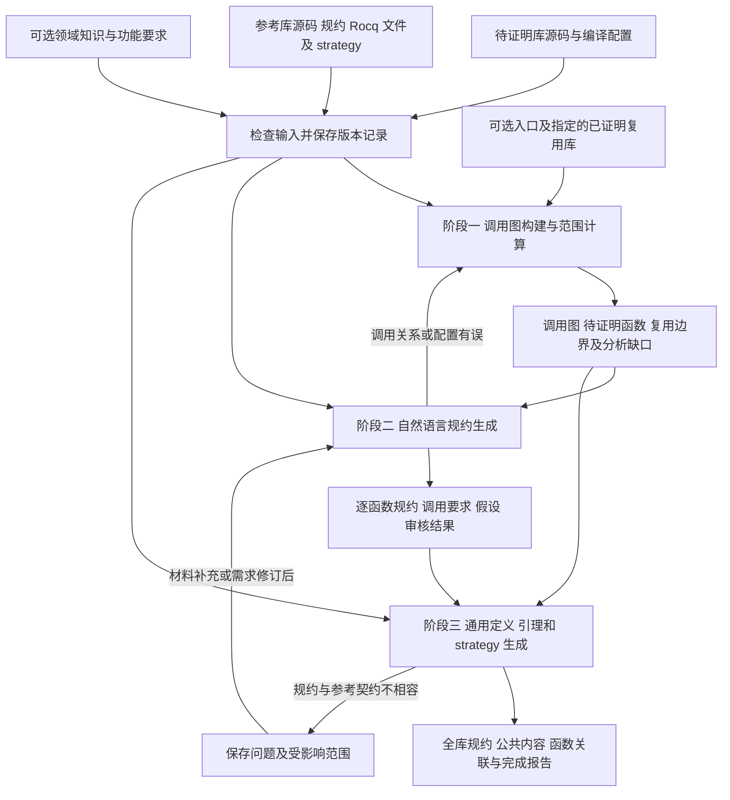
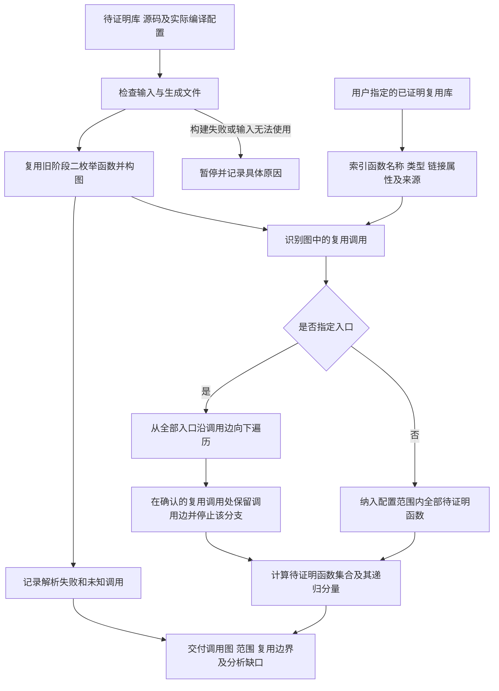
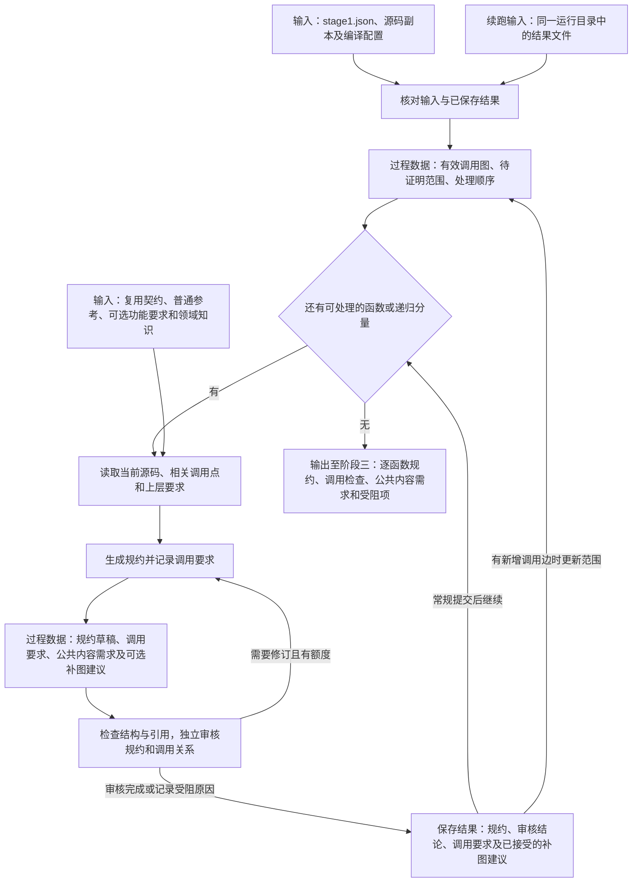

# 全库规约生成工具开发初稿

更新日期：2026-11-18。阶段一、二首版已实现，阶段三为开发计划。已实现接口见 [程序需求与接口](PROGRAM_REQUIREMENTS.md)。本文讨论新版流程，阶段编号与现有四阶段版本不同。各项输入输出使用业务名称，文件名、字段名及命令参数在后续讨论中确定。

## 1 目标与范围

新版取消模块划分和模块推荐，将待证明库作为一次任务的处理范围。用户提供源码、编译配置及参考材料后，工具构建待证明库的调用图。默认处理整个库，也可指定入口函数。工具为范围内全部待证明函数生成自然语言规约，再生成供这些规约使用的自然语言通用定义、引理（lemma）和 strategy。

一次任务应能自动推进全部函数，无需用户反复选择模块或批准下一批函数。执行过程中仍按调用关系和材料大小组织模型任务，逐步保存结果。全库处理不要求把全部源码和 Rocq 文件同时放入一个模型会话：现有材料读取、上下文预算和独立审核机制可以继续使用，批次只是内部执行安排，不改变用户要求的覆盖范围。

本版以 C 源码为主要对象，沿用当前函数分析后端。全库覆盖指选定源码及编译配置下的函数覆盖；不同平台和宏配置需要分别记录，不能从一种配置推断全部配置。汇编、无法解析的生成代码以及外部依赖必须列出，不能静默排除后宣称全库完成。

本版生成自然语言材料，不将自动编译 Rocq、安装 strategy 或完成 QCP 证明作为交付条件。已有 strategy 可以附原文；新生成 strategy 先描述适用条件、匹配对象、转换结果及依据。是否进一步输出可执行 strategy 文件，留待接口和验收要求明确后决定。

## 2 总体输入与输出

### 2.1 用户输入

| 输入 | 必须明确的内容 | 使用位置 |
| --- | --- | --- |
| 待证明库源码 | 项目根目录、源码与头文件、纳入范围及明确排除项、版本 | 全部阶段 |
| 待证明库编译配置 | 实际使用的编译数据库、平台和架构，以及配置所需的生成文件 | 阶段一构图，后续阶段据此理解具体实现 |
| 入口函数，可选 | 一个或多个可唯一定位的目标函数。省略时处理整个待证明库 | 阶段一确定待证明范围 |
| 已证明复用库，可选 | 指定可复用的库，提供源码目录、头文件及版本信息。优先复用目标项目的编译数据库，按需补充生成头文件和对应编译参数 | 阶段一建立函数索引和复用边界，阶段二检查调用处的契约适用性 |
| 参考库源码 | 一个或多个参考库的实现、版本及与证明材料的对应关系 | 阶段二按需比较；阶段三提取和适配 |
| 参考库规约 | 前后条件、资源表示、命名规约、适用配置与已证明范围 | 阶段二契约对照；阶段三复用判断 |
| 相关 Rocq 文件及 strategy | 定义、引理、证明、导入依赖和规则原文；必要的版本说明 | 阶段二补充理解；阶段三生成公共内容 |
| 领域知识，可选 | 用户提供的术语、数学背景、算法说明及使用限制 | 阶段二、三的语义分析 |

库的角色由用户声明。用户指定的复用库按已证明的库接收，可用于确定阶段一的遍历边界。其他参考材料供后续阶段对照。若未指定复用库，阶段一照常计算待证明范围。

源码和编译配置可以说明程序做什么，却不一定说明用户希望它做什么。初稿建议允许附带目标功能要求和公开接口说明；没有额外要求时，以源码行为和现有接口说明为依据，并明确记录推断出的假设。不能将工具自己猜测的算法意图作为用户已确认的要求。

### 2.2 最终输出

| 输出 | 内容及组织方式 |
| --- | --- |
| 逐函数自然语言规约 | 函数身份、适用配置、逻辑参数、前置条件、后置条件、资源归还、边界情形、调用要求、假设与审核结果 |
| 自然语言通用定义 | 数学对象或内存表示、参数含义、适用范围，与源码对象及函数规约的对应关系 |
| 自然语言引理 | 明确的前提和结论、依赖定义、使用位置，以及已有证明来源或待证明状态 |
| strategy | 已有规则原文及用途，或新规则的自然语言说明；标明依赖、适用条件及待验证事项 |
| 函数与公共内容关联 | 每个函数使用哪些定义、引理和规则，哪些需求尚未得到支持 |
| 范围与完成情况 | 待证明函数清单、已完成和受阻项、复用边界、外部依赖、分析缺口及配置范围 |

公共内容按共享对象保存，并建立到函数的引用，不要求为每个函数复制相同定义，也不要求每个函数都产生新的引理或 strategy。没有必要时写明原因；存在未满足的证明需求时不能将其写成“不需要”。

审核通过表示生成材料经过相应检查。新定义、引理和 strategy 仍需后续形式化及验证；引用参考库已证明内容时，证明状态只适用于原内容及其原配置。

## 3 总流程

三个阶段共享同一套输入版本和函数身份。上游结果改变时，下游受影响结果需要重新检查，不能只修改报告中的状态。初版可以采取保守失效策略，例如重查受影响调用分量及其下游内容，不必先实现精确的语义影响分析。

存在局部阻断时，保留已完成结果，并继续处理不依赖该问题的函数。全库报告应显示“部分完成”及具体缺口。若问题影响公共编译配置或全局资源模型，应停止所有依赖它的任务，等待处理。

## 4 阶段一 调用图构建与范围计算

阶段一复用旧版阶段二的函数枚举、FM-Agent、CodeGraph、Clang 构图及强连通分量计算。新版增加全库入口、复用库索引和范围计算。间接调用沿用旧后端提供的候选与诊断，本轮开发范围到此为止。

### 4.1 输入

| 输入 | 首版要求 |
| --- | --- |
| 待证明库 | 提供可编译的源码树、头文件和构建所需的生成文件 |
| 编译配置 | 提供实际使用的 `compile_commands.json` 及平台、架构说明。以对应配置确定纳入分析的编译单元，另行记录未纳入的源码和明确排除项 |
| 入口函数，可选 | 可指定一个或多个入口。裸函数名有歧义时，使用源码位置等信息唯一定位 |
| 已证明复用库，可选 | 指定复用库的源码目录、头文件和版本。签名依赖配置时，提供实际用到的生成头文件、宏、头文件搜索路径及架构设置。目标项目编译数据库已覆盖相关编译单元时直接使用，仅在需单独解析且数据库未覆盖时补充参数 |
| 输出位置 | 保存调用图、范围结果和诊断 |

用户负责准备构建配置和生成文件。工具在分析副本中读取这些输入，沿用旧版已经完成的编译配置修复，使用显式编译参数。已有规约、Rocq 文件和 strategy 随复用库交接，阶段一只记录其来源及可用位置。

### 4.2 流程

### 4.3 复用库索引与范围规则

先扫描用户指定的复用库，记录函数名、函数类型、链接属性、声明或定义位置、库身份和配置。函数类型包括返回类型、参数类型及是否为可变参数函数。索引用于识别调用目标，复用库的已证明状态由用户指定。

函数名和类型用于查找候选。只有源码归属或现有符号解析结果足以确认调用指向原复用库函数，且版本与配置匹配时，才建立复用边界。目标库自己的同名实现仍是待证明函数。同一库内不同文件的静态函数按定义位置区分。遇到多个匹配候选、复制或修改后的实现，或者缺少归属依据时，保留复用未确认记录。能确认属于待证明库的函数照常处理。

先构建待证明库的图，再计算范围。默认纳入本次编译配置范围内全部待证明函数，包括无已知调用者的函数。指定入口时，从每个入口遍历全部已识别的下层目标，合并共享依赖，纳入间接调用的已知候选。遇到确认的复用函数，保留调用者到该函数的边及契约来源，从这一调用边停止展开。已知的目标库回调仍须纳入相应范围。遍历继续到所有已识别的库内未证明函数都被纳入，内部批次和函数数量预算只影响执行安排。

### 4.4 输出与诊断

| 输出 | 交付内容 |
| --- | --- |
| 函数清单与调用图 | 可区分同名函数和条件实现的函数身份、源码位置、函数类型、调用点、已解析目标及候选依据 |
| 待证明范围 | 入口选择或全库范围，全部已识别的待证明函数，以及强连通分量和分量间依赖 |
| 复用边界 | 调用点、被调用函数、复用库身份、匹配依据、配置，以及可用的契约和证明材料位置 |
| 外部依赖 | 已识别的系统接口或其他库外调用及可用声明 |
| 分析覆盖与运行记录 | 未解析的调用、复用未确认项、未纳入编译配置的源码、解析诊断、输入摘要和工具版本 |

实际构建失败时暂停并记录失败条件，另行处理。编译成功后出现 Clang 解析失败，应作为分析器对当前配置或编译器特性的兼容问题记录。解析成功但函数指针目标不明确时，记录调用点、候选和已知限制。已识别的外部调用属于正常的依赖边界。只要分析缺口可能改变待证明范围，交付结果就应标明范围尚未确认完整。

阶段二以待证明函数清单安排规约生成，并在复用边界处检查调用者是否满足已有契约前提、已有保证是否足以支持调用者。该检查涉及调用处的证明责任，复用库内部的验证仍沿用已有结果。

### 4.5 开发任务与验收

1. 迁移旧版构图核心，增加直接读取源码树与实际编译数据库的入口。用真实后端确认生成头文件和编译条件能够被读取，核对普通项目及原有的显式编译配置行为。
2. 增加复用库扫描和索引，接入现有调用目标与版本、配置证据。用真实复用调用和同名同类型的本地实现验证截断条件。
3. 增加全库与多入口范围计算。验证无已知调用者的函数、共享依赖、递归、多层未证明依赖、复用调用和已识别的目标库回调都按范围规则处理。
4. 输出范围清单及诊断。分别验证运行输入无法使用、分析器解析失败、间接调用未解析和外部调用的记录，并核对分析缺口影响范围时的状态。

## 5 阶段二 自然语言规约生成

阶段二从阶段一的待证明范围出发，自动推进全部函数的规约生成。普通函数单独处理，互递归函数按强连通分量共同处理。用户启动一次任务即可。首版依次执行各任务，以便在结果写入后立即获得可续跑的进度。

### 5.1 输入、过程数据与输出

| 类别 | 数据 | 用途 |
| --- | --- | --- |
| 输入 | 阶段一的 `stage1.json` 及对应源码副本 | 读取函数范围、调用点、复用边界、编译配置和分析缺口 |
| 输入 | 已有复用契约与普通参考材料 | 核对复用调用，或按需对照目标函数的表示和语义 |
| 可选输入 | 功能要求、接口说明和领域知识 | 补充入口约定和数学背景 |
| 过程数据 | 当前有效调用图、待证明范围和处理顺序 | 从阶段一结果和已接受的补图建议计算 |
| 过程数据 | 当前函数的源码、上层调用要求、用到的参考原文、规约草稿和补图建议 | 提供给本次生成与独立审核 |
| 保存的结果 | 输入摘要、逐函数结果、审核意见、调用要求和已接受的补图建议 | 供续跑和阶段三读取。互递归函数共同提交 |
| 阶段输出 | 自然语言规约、公共内容需求、调用检查结果与受阻项 | 供阶段三定位需要的定义、引理、strategy 和原文依据 |

下面的流程图标明各步骤消耗和产生的数据。正式文件和字段名称见 [程序需求与接口](PROGRAM_REQUIREMENTS.md)。

### 5.2 流程图

### 5.3 生成与审核

按调用者优先顺序组织任务。处理一个被调用函数时，向模型提供所有已就绪的上层调用要求。每条要求通过函数 ID 和调用位置关联，记录调用条件、调用前可提供的参数和资源，以及返回后需要的保证。多个调用者的要求分别保留。公开接口使用用户需求和接口说明，缺少上层调用背景的函数依据自身实现生成，并说明相关假设。

自然规约继续采用现有书写规范。结果包含职责、符号、命名规约及 `With / Require / Ensure`，并说明返回结果、资源归还与边界情形。程序核对函数身份、调用位置和引用区间，独立审核者核对语义。递归分量共同审查，超出修订额度时保存目前结果与受阻原因。

已有复用契约由调用方审核，库内调用等被调用方规约就绪后随相应任务审核。检查调用者是否满足前置条件，以及被调用方的保证是否覆盖调用者所需的结果和资源。普通参考随任务按需读取，对照依据随相关条款一并保存。阶段二记录的是自然规约层面的检查结果，后续 QCP 流程仍需执行实际调用验证。

影响规约承诺的未知调用、缺失材料或契约冲突应明确标记。其余可处理函数继续推进。阶段结束时核对当前待证明范围，记录每个函数的结果或受阻原因，同时保留阶段一报告的覆盖缺口。

### 5.4 随规约生成补充调用边

生成任务读到明确的回调赋值或函数指针实参时，可以附一条补图建议。建议只需记录调用者、调用位置、候选目标、适用条件和对应源码。程序检查函数 ID 与引用，独立审核者在同一次审核中判断源码证据是否支持这条候选边。

程序保留阶段一原图，在计算当前范围时合并已接受的候选边。新增边会重新计算可达范围和递归分量，将新可达的函数及其依赖纳入任务。已保存结果若用到发生变化的调用点或上层要求，应重新检查。仍未查明的指针来源继续显示为分析缺口。候选目标无法在阶段一函数清单定位时，将发现记录给阶段一处理。

### 5.5 保存进度与续跑

首版使用一个运行结果文件，保存输入摘要、已完成或受阻的函数结果及已接受的补图建议。同一个函数的规约、审核结论和调用要求随结果一起写入。互递归组一次写完。每次完成任务，使用同目录的临时文件写完后原子替换运行结果文件。

使用同一运行目录执行 `--resume` 时，核对阶段一摘要，读取已有结果，再计算有效调用图、待证明范围和处理顺序。已接受的补图建议随运行结果保留，相关规约重新检查时仍可用于计算范围。调度器依据已有结果和当前依赖判断哪些任务仍需处理。输入和依赖仍一致的结果直接使用。中断发生在当前任务提交前时，重做这个函数或递归分量。

流程中的会话、源码补读过程和待处理队列只在当前执行时使用。采用单文件保存的代价是每次提交需要重写结果文件，首版可以用小库实测开销，再决定是否有必要分文件保存。

### 5.6 开发顺序与验收

1. **接入阶段一与旧版生成能力。** 先连接函数清单、调用点和强连通分量，复用旧版的材料读取、规约生成和独立审核。在一个能编译的小库中验证全范围调度，以及多个调用者和互递归函数的需求传递。
2. **接入调用检查和公共内容需求。** 用一个已有复用契约保证不足的案例，确认能定位受影响的调用点和规约条款。用一个需要公共表示或引理的条款检查阶段三是否能取得用途和原文位置。
3. **接入补图和续跑。** 用一个固定回调表或函数指针实参的漏边案例，确认新可达函数被自动处理，并保留其他未确定目标。完成若干函数后中断，再用同一目录续跑，确认已完成的结果可以直接使用，补图后的范围能从保存结果重建。

## 6 阶段三 参考检索与公共内容生成

阶段三直接读取阶段二的 `common_needs`，保留逐函数规约状态、调用检查和适用条件。程序静态索引参考库的 C 契约、Rocq 声明与 strategy，再按当前证明需要的前提、结论和资源形状筛选候选。模型在生成任务里读原文、检查适配并组织共享内容，随后由独立审核确认出处和用途。

公共定义、引理与 strategy 的输出逐项关联函数和规约用途。条件化规约可生成候选，检索、配置及证明缺口随结果交付。首版沿用阶段二的单文件续跑方式。

[阶段三详细开发方案](STAGE3_DEVELOPMENT_PLAN.md)记录输入输出、流程图、静态索引与工具接口、Simplex 的 FME 拆分重组用例及验收标准。

## 7 与当前代码的衔接

| 当前能力 | 新版处理方式 |
| --- | --- |
| 旧阶段一模块规划、选择和成对比较 | 从新版主流程移除；函数级参考对照在新阶段二重新组织 |
| 旧阶段二函数枚举和调用图适配 | 复用 `stage2/inventory.py`、`stage2/fm_graph.py` 及现有显式编译配置处理，增加全库入口和复用库索引 |
| 旧阶段二函数组选择与范围计划 | 新入口按全库或用户指定入口计算范围。复用依赖遍历与递归分量计算，规模评估用于安排内部批次 |
| 旧阶段三自然规约生成与独立审核 | 复用 `stage3/reference.py`、`reference_review.py` 及材料读取，增加全库调度、参考对照和递归协调 |
| 旧阶段四参考检索、引用校验及分项审核 | 复用 Reader、需求记录、共享参考和审核机制；扩展为可生成新公共内容的协议 |
| 旧阶段四恢复与输入修订 | 复用已有校验思路；新增阶段和内容类型需要重新绑定版本，不能直接沿用旧通过状态 |
| 规约与 strategy 写作规范 | 继续作为生成和审核的必读依据；新版职责扩展后同步更新相关 AGENTS.md，保留旧流程的职责说明 |

新版先使用独立入口和输出协议，保留现有四阶段流程用于对照。暂不直接重命名现有代码目录，避免阶段编号调整引起大范围导入和恢复兼容问题。业务阶段与代码目录的映射在开发文档中明确记录即可。

## 8 建议的开发顺序与验收

阶段一首版已完成构图迁移、复用库索引、范围计算和分析诊断。运行接口、结果字段和验收方式见 [程序需求与接口](PROGRAM_REQUIREMENTS.md)。

阶段二首版已接入全范围规约调度、调用检查、公共内容需求、补图及续跑。接口见 [程序需求与接口](PROGRAM_REQUIREMENTS.md)。

第三步按[阶段三开发方案](STAGE3_DEVELOPMENT_PLAN.md)接入需求、静态参考检索和公共内容生成。用 FME 拆分和重组验证无引理名称的查询、方向排序和适配证据，再检验审核与续跑。

第四步开展小型全库真实试运行，再扩大到实际目标库。程序测试检查调度、记录、引用、失效及恢复；真实模型试运行检查生成质量、遗漏、重复和错误适配。成本同时记录总模型调用、总输入输出量、耗时和补读次数，不只比较首包大小。

任务结束时必须逐项核对阶段一的待证明函数清单。清单中的每个函数都有规约及审核结论，或者有可追溯的未完成原因；每条公共内容需求都有处理结论。只有没有影响交付的阻断项时才报告全部完成。部分完成结果仍应可查看和继续执行。

## 9 下一轮需要明确的输入输出细节

1. 阶段二接入时，明确哪些阶段一分析缺口会阻断规约生成，以及范围修订后如何重新检查。
2. 功能要求如何提供：公开接口说明、用户需求和可选领域知识之间如何区分，冲突时由谁确认。
3. 如何记录参考源码、契约、Rocq 依赖和 strategy 的版本关系，供阶段二、三定位材料。
4. 自然语言产物的表达粒度：沿用现有命名规约格式的范围，定义和引理所需的数学精度，以及 strategy 是否仅交付自然语言候选。
5. 完成条件：哪些未知项允许作为限制交付，哪些必须阻断相关函数，以及真实试运行采用哪个小库作为首个验收对象。

这些问题明确后，再确定接口名称、文件布局及具体数据结构。本轮不预先将讨论中的字段固定为程序协议。
