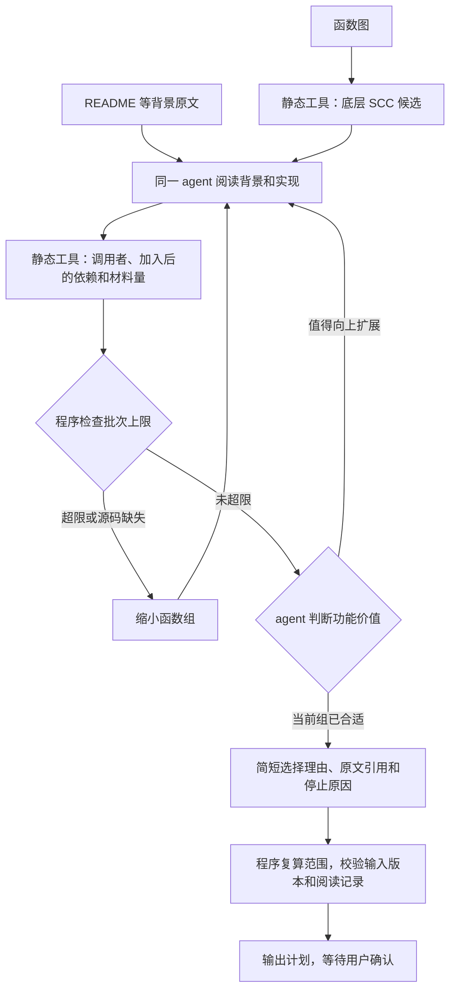

# 阶段二：选择当前处理的函数组

已有函数图之后，使用一个模型会话阅读原文并提出函数组。模型判断功能价值，程序计算依赖和预算；不先生成函数特性报告，也不增加第二个选择审核会话。最终范围仍由用户确认。

## 使用

```bash
python3 -m stage2.select \
  --input input --graph-run runs/new-graph \
  --background target-library/README.md \
  --output runs/new-selection \
  --max-targets 12 --max-generation 40 --max-material-chars 120000 \
  --calls 16 --seconds 900 --context-chars 60000
```

background 是 input 内的相对路径，可重复指定。target-library 应替换为本轮待证明库。程序先提供背景文件前 200 行，剩余部分按需读取。此命令调用模型；仅需静态计算时使用 stage2.demand_scope。

## 静态工具

| 工具 | 输入 | 返回内容 |
| --- | --- | --- |
| candidate_frontier | offset | 每页最多 10 个没有已知分量外出边的 SCC：函数 ID、名称、源码位置、未知调用数量 |
| direct_callers | target_ids、offset | 补齐被调用依赖后的函数组的直接调用者，每页最多 10 个 |
| evaluate_group | target_ids，可选 baseline_target_ids | 完整目标数、需求调用者数、相对前一组新增的函数和依赖数、已定位材料字符数、超限项、缺失和未知项数量 |
| scope_details | target_ids、section、offset | 成员或诊断的分页数据；section 为 target_ids、demand_ids、context_ids、missing_source、material_unknowns、unknown_calls、inventory_gaps |

工具返回还带有执行器计算的剩余调用、时间和上下文预算。静态评估在会话内缓存；重复调用复用源码解析结果。模型通过 read/search/list/batch 阅读原文，静态查询不授予已阅读记录。最终请求的每个目标函数必须已完整读取，理由需引用实际读过的背景与实现。



当前自动选择保留全部已识别上层需求调用者，不为降低成本自动截断需求。未知调用不视为没有依赖。已有自然规约不视为已证明契约，不自动从未处理依赖中扣除；已验证契约的适用性匹配尚未实现。

## 预算及材料检查

- max-targets：补齐被调用依赖后的目标函数数量上限。
- max-generation：目标函数加需求调用者的数量上限。
- max-material-chars：上述函数实现及静态找到的类型、宏原文的 JSON 序列化字符数上限；同一文件的重叠区间只计一次。
- calls、seconds、context-chars：当前选择会话的实际调用、时间和上下文上限。

前三项是批次工作量限制，不是阶段三实际请求大小。后续规约、参考阅读、提示、总 token、耗时和证明难度不能提前精确计算。源码缺失是确定的问题；无法解析的 include、调用及配置保留为未知。已定位材料未超限不表示语义材料充分，阶段三仍执行自己的输入检查。

## 输出

| 文件 | 具体内容 |
| --- | --- |
| selection.json | 初始目标 ID、功能价值理由、停止原因、原文引用、静态评估标识 |
| assessment.json | 完整范围、数量、材料字符数、上限、缺失及未知项 |
| scope-plan.json、SCOPE.md、graph.json | 与现有范围规划兼容的计划和投影图 |
| identity.json、task/、status.json | 来源、配置、会话、工具记录及执行状态 |

成功为 pending_user_review，user_approved=false。用户确认后，向阶段三提供 scope-plan.json 和批准的 plan_digest；选择器不生成规约或证明。

无法提出合适批次时保存 selection_unavailable 及原因，不输出范围计划。中断或预算耗尽保留任务记录，不冒充选择成功。

实现：[select.py](select.py)、[selection_tools.py](selection_tools.py)。回归使用模拟模型，不代表真实模型选择质量已验证。

本轮验证：完整单元测试 377 项，374 项通过、3 项跳过；包含单会话选择到范围计划加载的模拟模型测试。未调用真实模型或执行证明。
